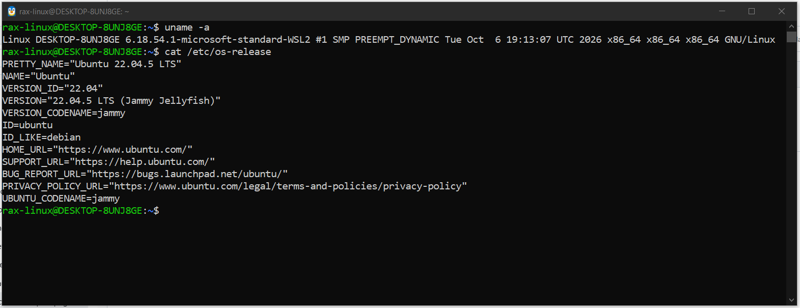
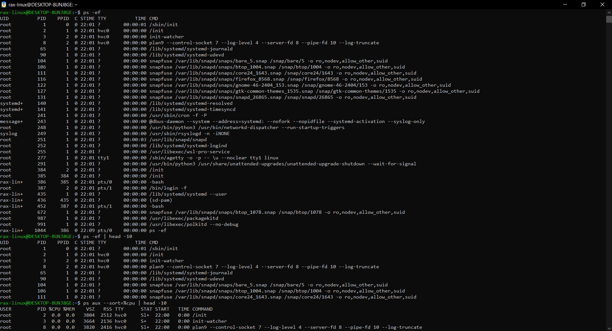
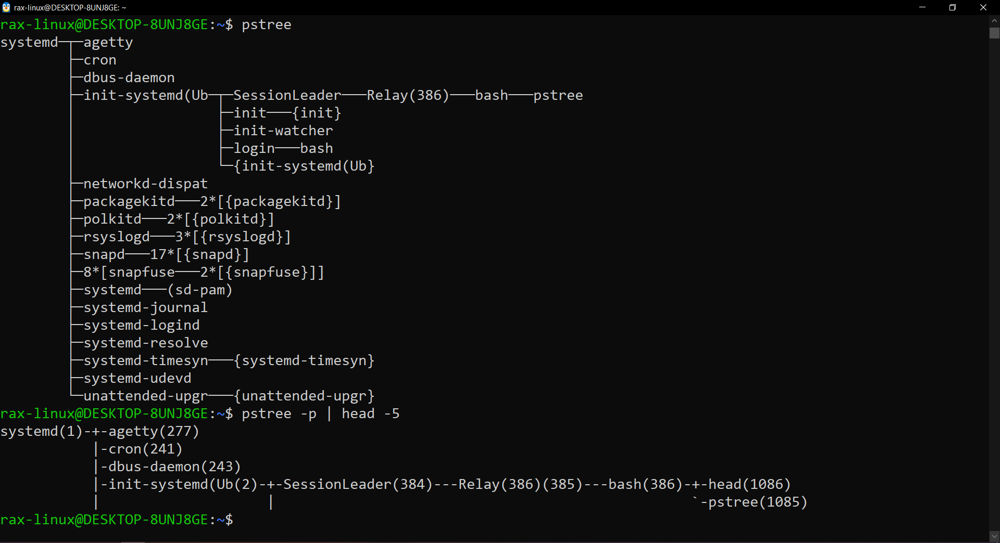
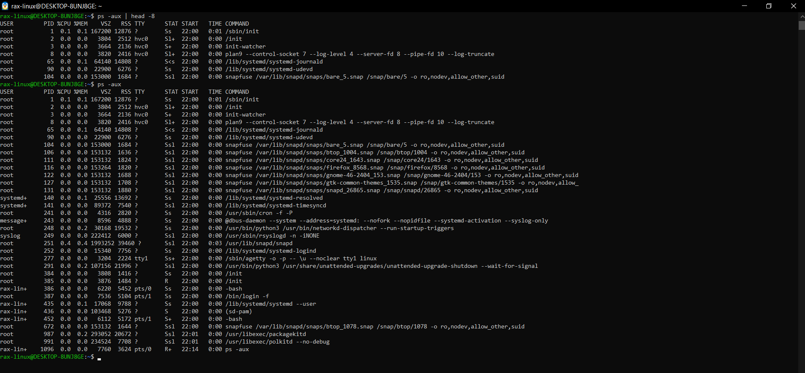
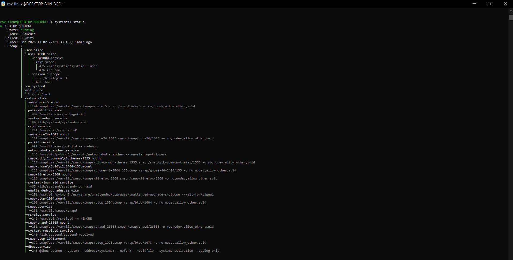
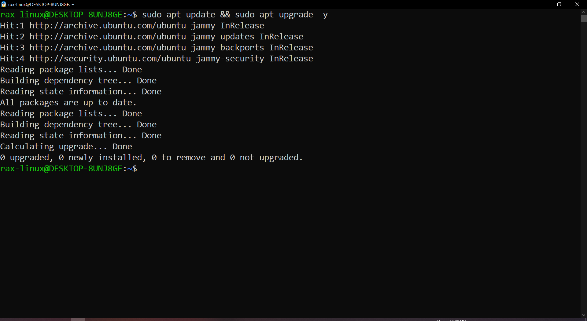
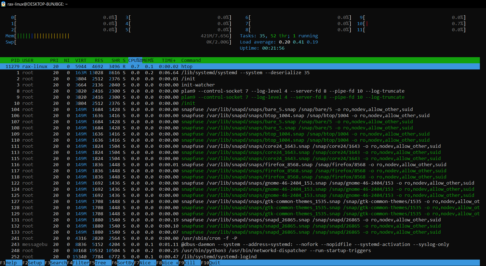
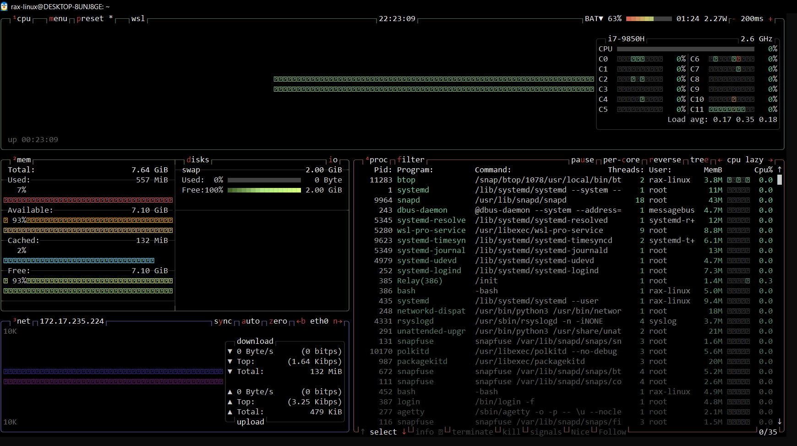

# Linux Architecture Notes (Day 02)

## Linux components

- Hardware - CPU, RAM, disk, network card etc.
- Kernel - brain of Linux. Manages CPU, memory, processes and devices. Apps can't talk to hardware directly, they go through the kernel (system calls).
- User space - where all the apps and the shell run. If an app crashes here the kernel is still fine.
- Shell (bash) - takes my command and asks the kernel to run it.
- systemd - first process that starts at boot, PID 1. Everything else starts from it.

Boot flow: BIOS/UEFI -> GRUB -> kernel -> systemd -> services -> login

## Processes

A process is just a program that's running. Every process gets a PID.

How a new process gets created (example: running `ls` in bash):
1. bash makes a copy of itself with `fork()`
2. the copy (child) loads `ls` with `exec()`
3. `ls` finishes and bash gets the exit code back

So every process has a parent (PPID). If you keep going up you end up at PID 1. `pstree -p` shows this tree.

The kernel scheduler decides which process gets the CPU and for how long.

Managing them:
- foreground job runs in the terminal, Ctrl+C stops it
- background job, add `&` at the end
- `kill <PID>` sends SIGTERM (asks it to stop nicely)
- `kill -9 <PID>` sends SIGKILL (force, only if TERM doesn't work)

## Process states

You can see these in the STAT column of `ps aux`.

| State | Meaning |
|---|---|
| R | running or waiting for CPU |
| S | sleeping, waiting for something like input or network. most processes are in this state |
| D | uninterruptible sleep, usually stuck on disk I/O. even kill -9 doesn't work on it |
| T | stopped (Ctrl+Z does this, `fg` to resume) |
| Z | zombie, process is done but parent didn't read its exit status. can't kill it, have to fix/restart the parent |

## systemd

systemd is the init system on most distros now (Ubuntu, Debian, RHEL etc).

What it does:
- starts services at boot in the correct order
- restarts a service if it crashes (if `Restart=` is set in the unit file)
- logs of all services go to journald, you read them with `journalctl`

Why it matters: if a service goes down in prod, first thing I check is `systemctl status` and then the logs with journalctl.

```bash
systemctl status nginx
systemctl start nginx
systemctl stop nginx
systemctl restart nginx
systemctl enable nginx      # start on boot
systemctl disable nginx
journalctl -u nginx         # logs of nginx
```

(start/stop/restart/enable need sudo)

## 5 commands I use daily

1. `top` - live CPU and memory usage, shows which process is using the most
2. `ps -ef` - list all running processes
3. `systemctl` - manage services
4. `df -h` - check disk space
5. `free -h` - check memory

For server monitoring I also use:
- `htop` - better version of top, colors, scroll, can kill a process with F9
- `btop` - shows CPU, memory, disk and network graphs on one screen

htop from apt (`sudo apt install htop`), btop I installed with snap (`sudo snap install btop`)

## What I ran on my machine

I'm using Ubuntu 22.04 on WSL2 (Windows). All screenshots are in the `Screenshots` folder.

### 1. Kernel and OS version
`uname -a` and `cat /etc/os-release`



### 2. All processes
`ps -ef` and `ps aux --sort=%cpu`

PID 1 is `/sbin/init` and its PPID is 0, so nothing started it, the kernel did. Also learned `--sort=%cpu` puts the lowest CPU first, to get the heavy ones on top you need a minus: `--sort=-%cpu`



### 3. Process tree
`pstree` and `pstree -p`

Everything comes under systemd(1). My bash and even the pstree command itself show up in the tree. ps showed PID 1 as `/sbin/init` but pstree shows `systemd`, because /sbin/init is just a link to systemd.



### 4. ps aux and the STAT column
Almost everything is `S` (sleeping), only a couple are `R` and one of them is the ps command itself. The extra letters after the state:
- `s` - session leader
- `l` - multi-threaded
- `+` - running in foreground
- `<` - high priority



### 5. systemctl status
Without a service name it shows the whole system. State is running, 0 failed units, and the full tree of services under system.slice.



### 6. apt update and upgrade
Updated the system first before installing anything.



### 7. htop
12 CPU cores, about 421M RAM used out of 7.65G, load average is very low (0.20) so the system is basically idle.



### 8. btop
Same info as htop but with graphs, and it also shows disk and network.


