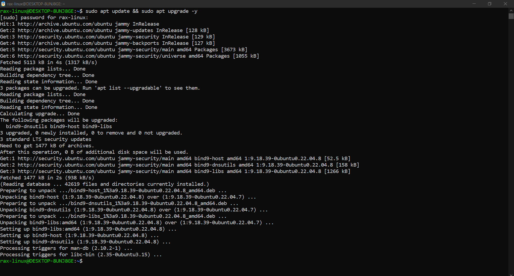
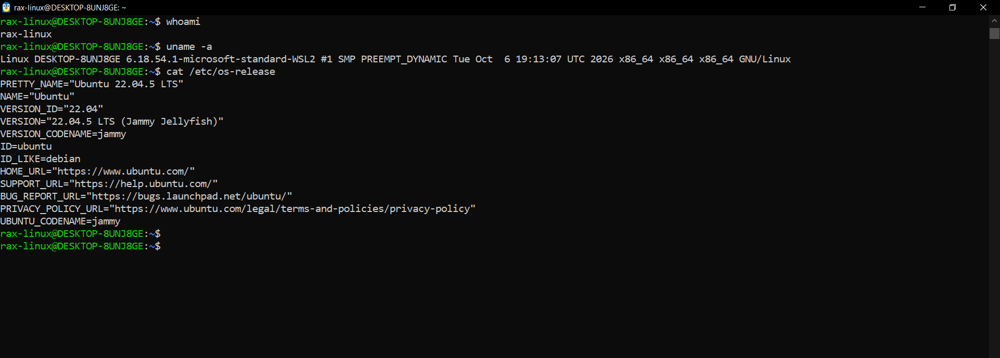
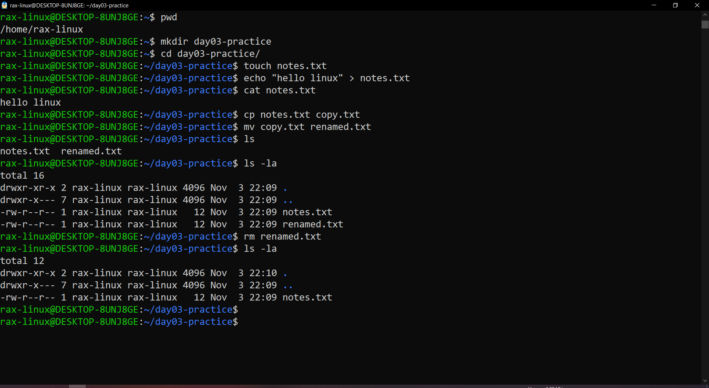
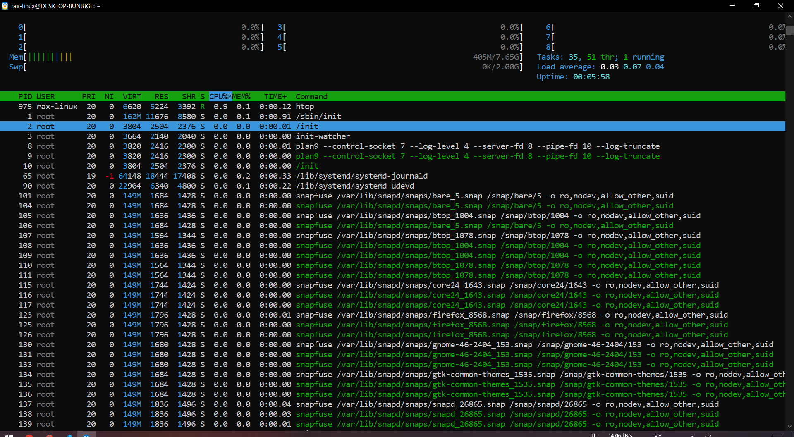
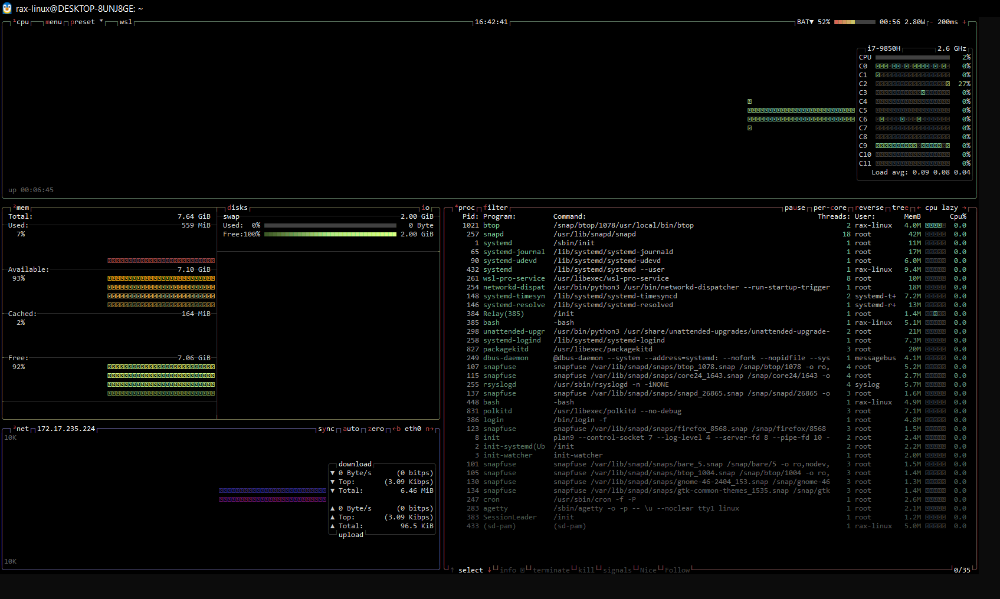
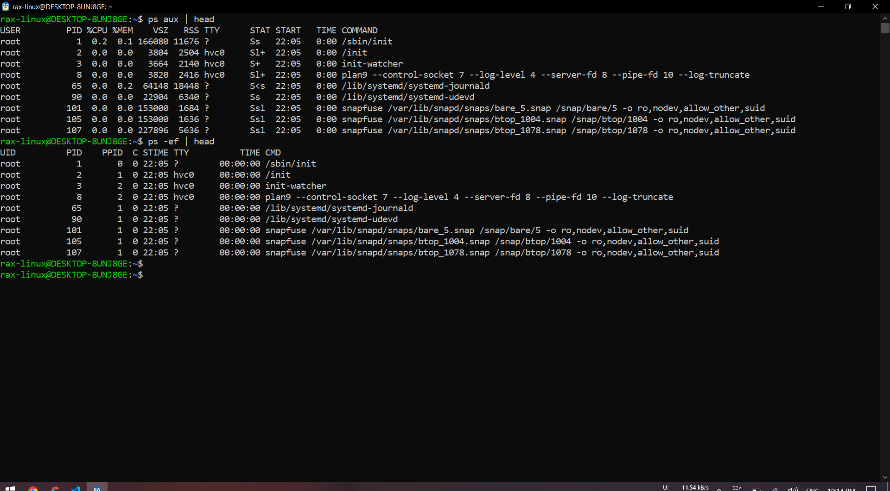
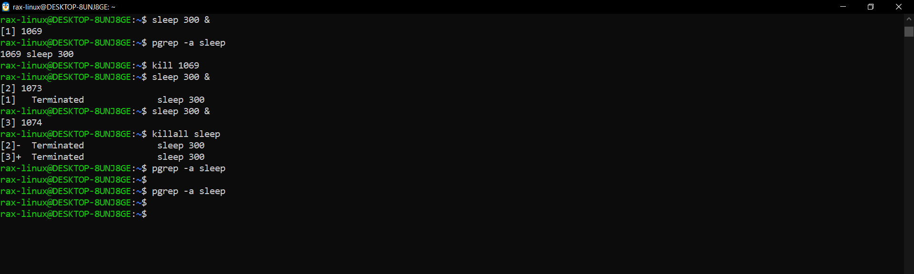
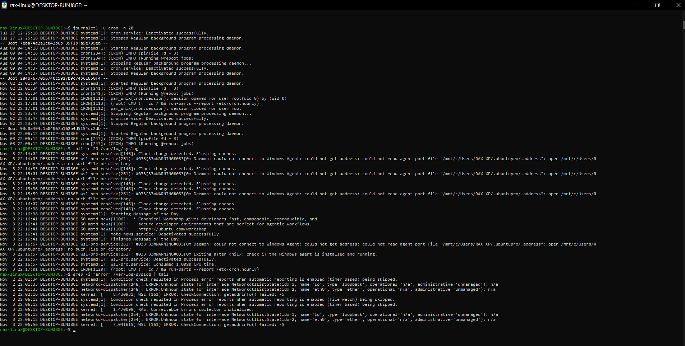
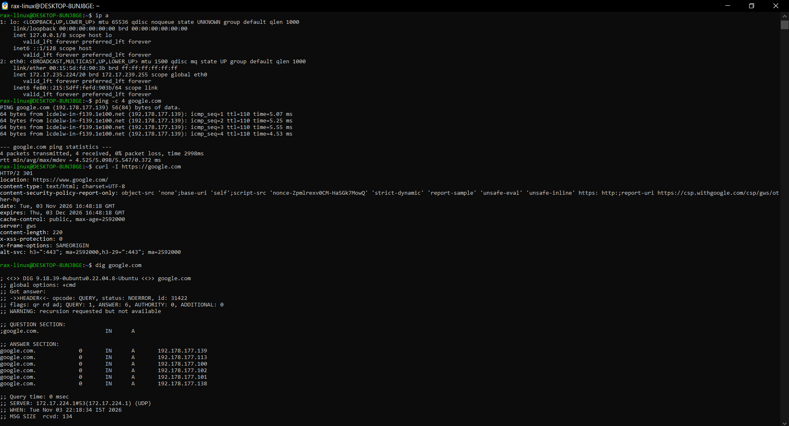

# Linux Commands Cheat Sheet (Day 03)

My list of commands I use the most. Grouped so I can find them fast.

## Basic

- `whoami` - shows my username
- `uname -a` - shows kernel and system info
- `cat /etc/os-release` - shows which Linux I am using
- `history` - shows old commands I typed
- `man ls` - help page of a command (press q to exit)
- `clear` - clears the screen

## Install software (apt)

- `sudo apt update` - gets the latest list of packages
- `sudo apt upgrade -y` - updates all installed packages
- `sudo apt install htop` - installs a package
- `sudo apt remove htop` - removes a package
- `sudo snap install btop` - installs btop using snap

## Files and folders

- `pwd` - shows which folder I am in
- `ls -la` - shows all files, hidden files also
- `cd folder` - go inside a folder
- `cd ..` - go one folder back
- `mkdir test` - makes a new folder
- `touch file.txt` - makes a new empty file
- `cat file.txt` - shows what is inside a file
- `nano file.txt` - opens a file to edit (Ctrl+O save, Ctrl+X exit)
- `cp a.txt b.txt` - copies a file
- `mv a.txt b.txt` - moves or renames a file
- `rm file.txt` - deletes a file (no undo!)
- `rm -r folder` - deletes a folder
- `find . -name "*.log"` - finds files by name
- `df -h` - shows free disk space
- `du -sh folder` - shows size of a folder
- `chmod +x script.sh` - makes a script runnable

## Processes

| Command | What it does | Tip |
|---|---|---|
| `ps aux` | all processes with user, PID, CPU, memory, state | add `\| head` to see only the top |
| `ps -ef` | all processes with PPID (parent) and start time | good to see who started what |
| `pstree -p` | process tree with PIDs | everything starts from PID 1 |
| `top` | live CPU and memory use | press q to quit |
| `htop` | same as top but easier to read | F9 to kill, F10 to quit |
| `btop` | same thing with graphs | `sudo snap install btop` |
| `pgrep -a bash` | finds PIDs by name and shows the full command | easier than `ps aux \| grep` |
| `pidof bash` | just the PIDs of a program | name must match exactly |
| `ps -o pid,pcpu,pmem,comm -p <PID>` | CPU and memory of one process | good to paste in a ticket |
| `kill <PID>` | stops a process nicely | try this first |
| `kill -9 <PID>` | force stops a process | last option |
| `killall sleep` | stops all processes with that name | check the name twice |
| `free -h` | how much RAM is free | |
| `systemctl status cron` | checks if a service is running | |
| `sudo systemctl restart cron` | restarts a service | |

## Logs

- `tail -f /var/log/syslog` - shows new log lines live (Ctrl+C to stop)
- `journalctl -u cron` - shows logs of a service
- `grep -i "error" /var/log/syslog` - finds lines with "error" in a file

## Network

- `ip a` - shows my IP address
- `ping -c 4 google.com` - checks if a server is reachable
- `curl -I https://google.com` - checks if a website is working
- `dig google.com` - shows the IP of a domain (DNS)
- `ss -tuln` - shows which ports are open

## If a service is not working

1. `systemctl status <service>` - is it running?
2. `journalctl -u <service>` - check the logs for errors
3. `ping` / `curl` - check if the network is fine

---

# Hands-on: what I ran on my machine

Ubuntu 22.04 on WSL2. I ran these one by one and took a screenshot after each step.

### 1. Update the system

```bash
sudo apt update && sudo apt upgrade -y
```

3 packages got upgraded, all bind9 ones. bind9-dnsutils is the package that gives `dig`, so dig was already there.



### 2. Basic info

```bash
whoami
uname -a
cat /etc/os-release
```

I'm `rax-linux`, running Ubuntu 22.04.5 LTS on a WSL2 kernel.



### 3. Files and folders

```bash
pwd
mkdir day03-practice
cd day03-practice
touch notes.txt
echo "hello linux" > notes.txt
cat notes.txt
cp notes.txt copy.txt
mv copy.txt renamed.txt
ls -la
rm renamed.txt
ls -la
```

`echo "..." > file` writes text into a file. After `rm` only notes.txt is left.



### 4. Disk and memory

```bash
df -h
du -sh ~
free -h
```

My Windows drives also show up here as `/mnt/c` and `/mnt/s`. Home folder is only 140K. RAM is 7.6G and only around 400M is used.


### 5. htop

```bash
htop
```

Load average is 0.03, so the system is almost idle. Only htop itself is in `R` state.



### 6. btop

```bash
btop
```

Shows all 12 cores of my i7 separately, plus memory, disk and network in one screen.



### 7. ps aux and ps -ef

```bash
ps aux | head
ps -ef | head
```

`ps aux` shows CPU, memory and STAT. `ps -ef` shows the PPID, like systemd-journald has PPID 1, so systemd started it.



### 8. Process tree and finding PIDs

```bash
pstree -p | head -15
pgrep -a bash
pidof bash
ps -o pid,pcpu,pmem,comm -p 1
```

`pgrep` and `pidof` both found my 2 bash shells (385 and 448). PID 1 is systemd using just 0.1% CPU.


### 9. Start a process and kill it

`sleep` just waits, so it's safe to practice kill on it.

```bash
sleep 300 &
pgrep -a sleep
kill 1069
sleep 300 &
sleep 300 &
killall sleep
pgrep -a sleep
```

`kill 1069` stopped the first one. `killall sleep` stopped both of the others in one go. Last `pgrep` shows nothing, so all are gone.



### 10. Services

```bash
systemctl status cron
```

cron is `active (running)` and `enabled`, so it starts on boot. Main PID is 247, same as in pstree.


### 11. Logs

```bash
journalctl -u cron -n 20
tail -n 20 /var/log/syslog
grep -i "error" /var/log/syslog | tail
```

journalctl also shows logs from old boots (the `-- Boot --` lines). The errors from grep are from networkd-dispatcher and WSL, they are normal on WSL and nothing is broken.



### 12. Network

```bash
ip a
ping -c 4 google.com
curl -I https://google.com
dig google.com
```

- my eth0 IP is 172.17.235.224 (private WSL IP)
- ping: 0% packet loss, around 5 ms
- curl gives `HTTP/2 301`, that means the site is up and just redirecting to www.google.com
- dig shows 6 IPs for google.com


