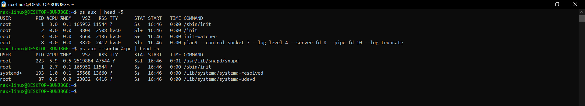
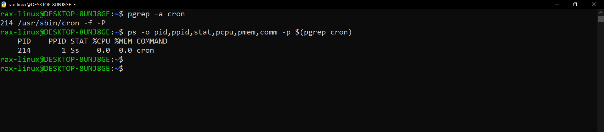
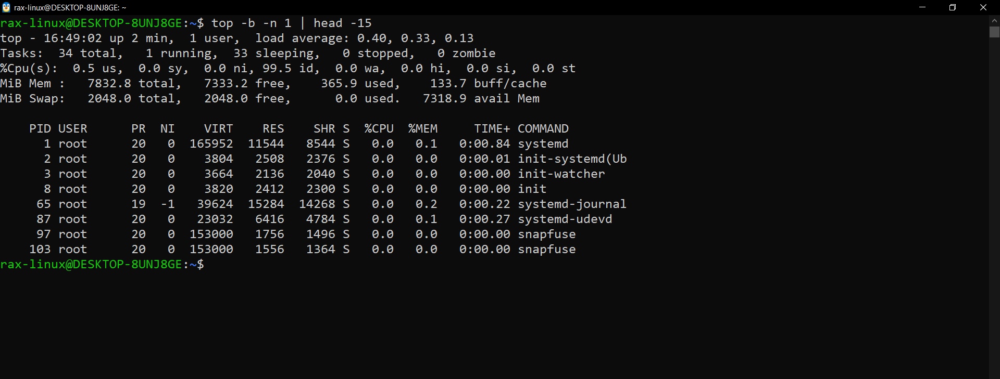

# Linux Practice (Day 04)

Ubuntu 22.04 on WSL2. The service I picked to inspect is **cron** (it runs scheduled jobs in the background).

---

## 1. Process checks

### ps

```bash
ps aux | head -5
ps aux --sort=-%cpu | head -5
```



The first command shows the first few processes, and PID 1 is /sbin/init (systemd).
I had just started WSL, so snapd was using the most CPU at 5.9%.

### pgrep

```bash
pgrep -a cron
ps -o pid,ppid,stat,pcpu,pmem,comm -p $(pgrep cron)
```



cron is running as PID 214 and its parent is PID 1, so systemd started it.
It's using 0% CPU because it just sits and waits for the next job.

### top

```bash
top -b -n 1 | head -15
```



34 tasks in total, 1 running, 33 sleeping and 0 zombies.
CPU is 99.5% idle, so my system is basically doing nothing right now.

---

## 2. Service checks (cron)

### systemctl status

```bash
systemctl status cron --no-pager
systemctl is-active cron
systemctl is-enabled cron
```


cron is active (running) and enabled, so it will also start on every boot.
I added --no-pager so the full output prints at once and fits in the screenshot.

### list running and failed services

```bash
systemctl list-units --type=service --state=running | head -15
systemctl list-units --type=service --state=failed
```


14 services are running right now, like cron, rsyslog, snapd and systemd-journald.
The failed list shows 0 units, so nothing has crashed since boot.

### unit file

```bash
systemctl cat cron
```


ExecStart is the command systemd runs, and Restart=on-failure means it restarts cron only if it crashes.
WantedBy=multi-user.target is the reason cron starts on boot.

---

## 3. Log checks

```bash
journalctl -u cron -n 20 --no-pager
journalctl -u cron --since "1 hour ago" --no-pager
journalctl -u cron --no-pager | grep -iE "fail|error"
tail -n 50 /var/log/syslog | grep -i cron
```


journalctl shows cron logs from the last 3 boots, and cron runs the hourly jobs at :17 every hour.
The grep for fail/error and the syslog tail gave no output, so there are no errors.

---

## 4. Mini troubleshooting

### Case 1: service is down

I stopped cron on purpose and then checked it like it was a real issue.

```bash
sudo systemctl stop cron
systemctl status cron --no-pager
pgrep -a cron
journalctl -u cron -n 5 --no-pager
sudo systemctl start cron
systemctl is-active cron
systemctl status cron --no-pager
```


After stop, cron was inactive (dead) with signal=TERM, so systemctl stop sends the same signal as kill.
After start it came back as active, but with a new PID 583 instead of 214.

### Case 2: a process eating CPU

`yes` keeps printing "y" forever, so it uses a full CPU core. Safe way to practice.

```bash
yes > /dev/null &
ps aux --sort=-%cpu | head -5
kill 590
ps aux --sort=-%cpu | head -5
```


yes was on top with 104% CPU, so it was eating a full core.
I killed it with kill 590 and it showed Terminated, but another yes was still running (see below).

---

## Problems I hit

**There were 2 `yes` processes, not 1.** I had started `yes` once before by mistake (PID 588). After `kill 590`, the second `ps` still showed PID 588 at 97.8% CPU. So I had to kill that one too:

```bash
pgrep -a yes
kill 588
pgrep -a yes
```


pgrep found the old yes still running as PID 588, so I killed it with kill 588.
The second pgrep shows only Terminated and no yes left, so now the CPU is free.

Lesson: always check again after the fix. If I didn't run `ps` one more time, I would have thought the problem was gone.

---

## My troubleshooting order

1. `systemctl status <service>` - is it running?
2. `journalctl -u <service>` - what do the logs say?
3. `ps` / `top` - is something eating CPU or memory?
4. fix it - restart the service or kill the process
5. check again to make sure it's really fixed
