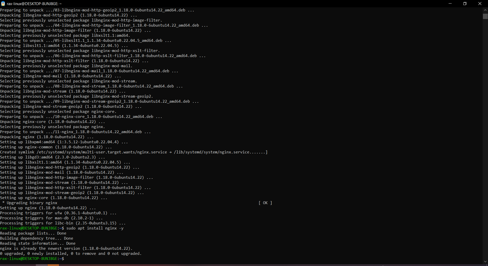
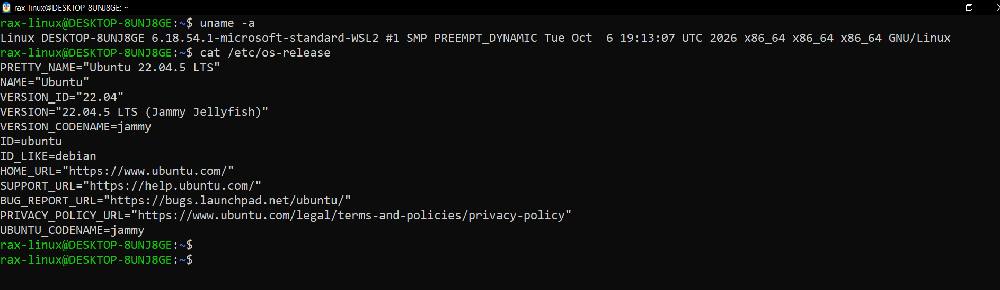

# Linux Troubleshooting Runbook (Day 05)

## Target service

**nginx** (web server) on Ubuntu 22.04, WSL2.
I picked nginx because it has a port, a URL and its own log files, so I can check every part of it.

### Setup

```bash
sudo apt install nginx -y
```



nginx 1.18.0 got installed and apt created a link in multi-user.target.wants, so it starts on boot.
Running the install again just says it's already the newest version.

---

## 1. Environment basics

```bash
uname -a
cat /etc/os-release
```



Kernel is 6.18.54.1 (WSL2, x86_64) and the OS is Ubuntu 22.04.5 LTS.
This tells me it's a Debian type system, so apt, systemd and /var/log/syslog.

---

## 2. Filesystem sanity

```bash
mkdir /tmp/runbook-demo
cp /etc/hosts /tmp/runbook-demo/hosts-copy && ls -l /tmp/runbook-demo
ls /tmp/
ll /tmp/
```


The folder and the 612 byte copy got created without any error, so the disk is writable.
/tmp has `drwxrwxrwt`, the `t` at the end means anyone can write there but can only delete their own files.

---

## 3. Snapshot: CPU and memory

```bash
pgrep -a nginx
ps -o pid,ppid,pcpu,pmem,comm -p $(pgrep -d, nginx)
free -h
top -b -n 1 | head -15
```


nginx has 1 master (PID 941, parent is systemd) and 12 workers, one for each of my 12 CPU cores, all at 0% CPU.
RAM is 7.6G with 7.1G available, and top shows 99.5% idle with 0 zombies, so the system is healthy.

---

## 4. Snapshot: Disk and IO

```bash
df -h /
du -sh /var/log
sudo du -sh /var/log/* | sort -h | tail -5
vmstat 1 5
```


Root disk is only 1% used, /var/log is 283M and 281M of that is just the journal (without sudo, du gave Permission denied).
vmstat shows 100% idle, 0 wa and 0 swap, so nothing is waiting on the disk.

---

## 5. Snapshot: Network

```bash
sudo ss -tulpn | grep nginx
curl -I http://localhost
```


nginx is listening on port 80 for both IPv4 (0.0.0.0:80) and IPv6 ([::]:80), with all 13 nginx PIDs on it.
curl got `HTTP/1.1 200 OK` from nginx/1.18.0, so the website is actually working, not just running.

---

## 6. Logs reviewed

```bash
journalctl -u nginx -n 50 --no-pager
journalctl -u nginx -p warning --since "1 hour ago" --no-pager
sudo tail -n 50 /var/log/nginx/access.log
sudo tail -n 50 /var/log/nginx/error.log
```


journalctl only shows nginx starting at 21:13, and the warning filter says `-- No entries --`, so no problems.
access.log has my own curl request (HEAD / 200) and error.log has only one notice, no real errors.

---

## Quick findings

- nginx is up: 1 master + 12 workers, listening on port 80, curl gets 200 OK
- CPU is 99.5% idle, 7.1G RAM available, no swap used, no zombies
- disk is 1% used, almost all of /var/log is the journal (281M)
- no warnings or errors in journalctl or nginx error.log

---

## If this worsens

1. **Restart, but safely** - first test the config with `sudo nginx -t`. If only the config changed, use `sudo systemctl reload nginx` (no downtime). If nginx is stuck, `sudo systemctl restart nginx`. Then check again with `systemctl status nginx` and `curl -I http://localhost`.
2. **Get more logs** - watch logs live while the problem happens: `journalctl -u nginx -f` and `sudo tail -f /var/log/nginx/error.log`. If that's not enough, change `error_log` to `info` level in `/etc/nginx/nginx.conf` for a short time, then change it back.
3. **Save the evidence before escalating** - save `ps aux --sort=-%cpu | head`, `free -h`, `df -h` and `journalctl -u nginx --since "1 hour ago"` into a file. If the process looks stuck, run `sudo strace -p <PID> -c` for a few seconds to see what it's doing.
