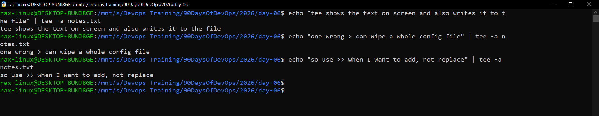
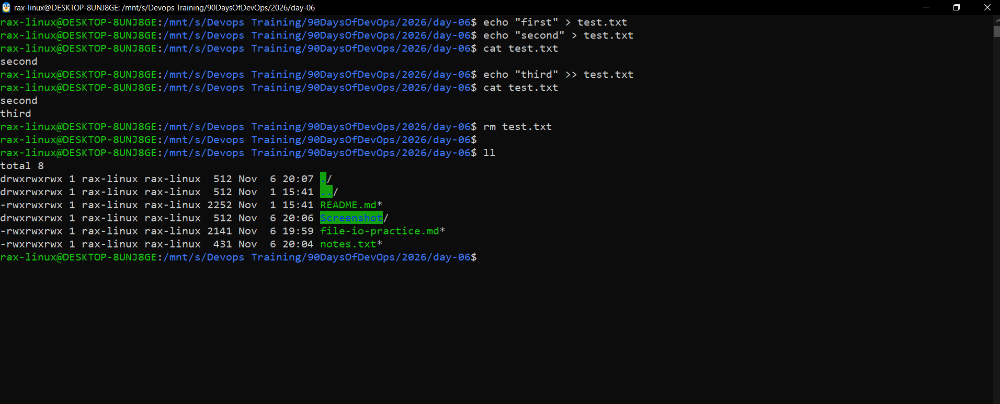
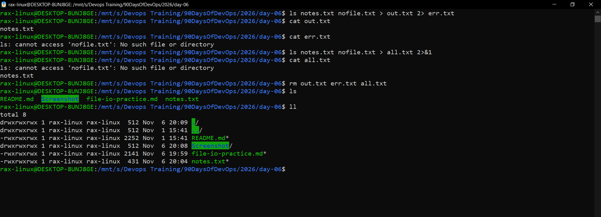

# File Read and Write Practice (Day 06)

Ubuntu 22.04 on WSL2. I ran everything inside this `day-06` folder, so `notes.txt` is saved right here next to this file.

```bash
cd "/mnt/s/Devops Training/90DaysOfDevOps/2026/day-06"
```

---

## 1. Create the file

```bash
touch notes.txt
ll
ls -l notes.txt
```


`touch` made an empty notes.txt, size 0 bytes.
Permissions show `-rwxrwxrwx` because this folder is on my Windows drive (/mnt/s), and Windows drives don't keep Linux permissions.

---

## 2. Write the first line with `>`

```bash
echo "Day 06 - file read and write practice" > notes.txt
cat notes.txt
```


`>` wrote the first line into the empty file.
cat shows that one line, so the write worked.

---

## 3. Add more lines with `>>`

```bash
echo "> writes to a file and replaces everything in it" >> notes.txt
echo ">> adds a new line at the end of the file" >> notes.txt
echo "cat shows the whole file" >> notes.txt
echo "head shows the first lines, tail shows the last lines" >> notes.txt
echo "tail -f is used to watch logs live" >> notes.txt
echo "logs, configs and scripts are all text files" >> notes.txt
cat -n notes.txt
```


Each `>>` added one line at the end, and `cat -n` shows 7 numbered lines.
Line 1 is still there, so `>>` adds without deleting anything.

---

## 4. Write and show at the same time with `tee`

```bash
echo "tee shows the text on screen and also writes it to the file" | tee -a notes.txt
echo "one wrong > can wipe a whole config file" | tee -a notes.txt
echo "so use >> when I want to add, not replace" | tee -a notes.txt
```



Every line got printed on the screen and saved to the file at the same time.
I used `-a` because `tee` without it would replace the whole file, just like `>`.

---

## 5. Read the full file

```bash
cat notes.txt
wc -l notes.txt
```


cat shows all the lines in the right order, nothing got lost.
`wc -l` says 10 lines, which is inside the 8 to 12 limit.

---

## 6. Read only parts of the file

```bash
head -n 2 notes.txt
tail -n 2 notes.txt
```


`head -n 2` gave the first 2 lines and `tail -n 2` gave the last 2 (the ones I added with tee).
On a big log file this is much better than cat, because I only see what I need.

---

## 7. `>` vs `>>` test

I tested this on a separate file so `notes.txt` stays safe.

```bash
echo "first" > test.txt
echo "second" > test.txt
cat test.txt
echo "third" >> test.txt
cat test.txt
rm test.txt
ll
```



The second `>` replaced "first" completely, so cat only shows "second".
Then `>>` added "third" below it. After `rm`, ll shows test.txt is gone.

---

## 8. Errors go to a different place (`2>` and `2>&1`)

`nofile.txt` doesn't exist, so `ls` gives one normal output and one error.

```bash
ls notes.txt nofile.txt > out.txt 2> err.txt
cat out.txt
cat err.txt
ls notes.txt nofile.txt > all.txt 2>&1
cat all.txt
rm out.txt err.txt all.txt
ls
```



With `> out.txt 2> err.txt` the normal output and the error went into 2 different files.
With `2>&1` both went into all.txt. After `rm`, only my real files are left in the folder.
