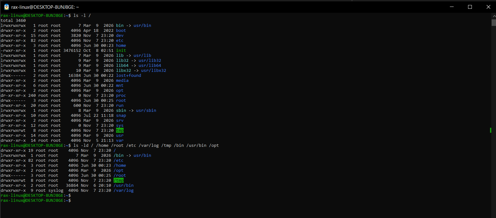
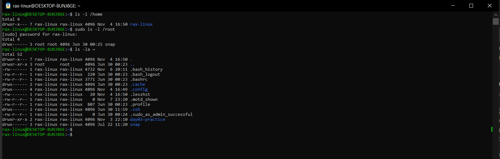
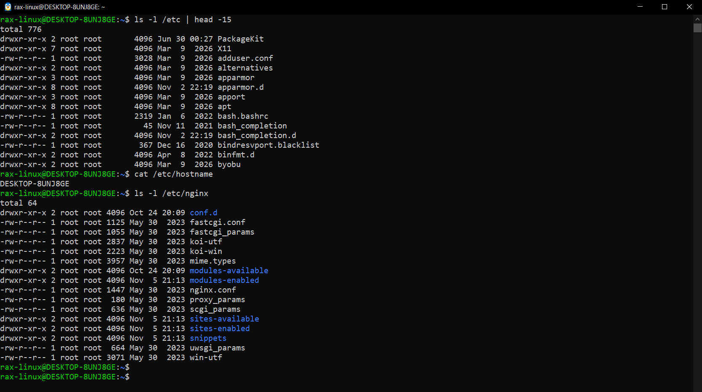
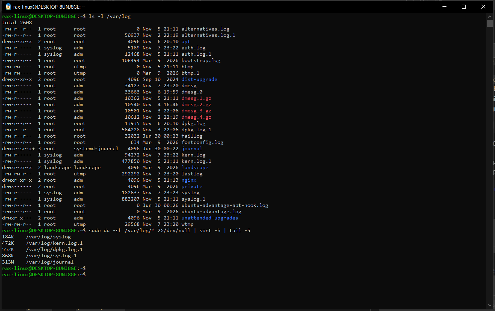
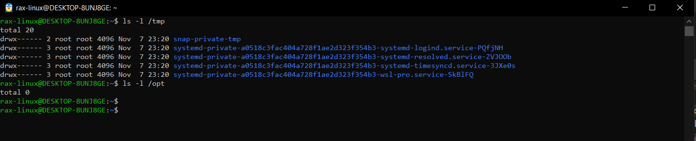
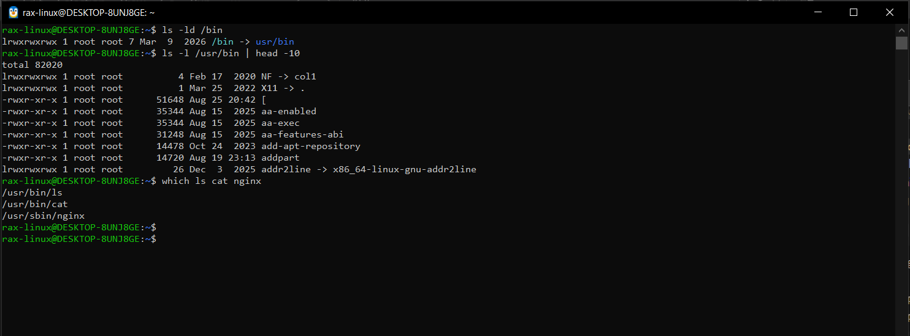
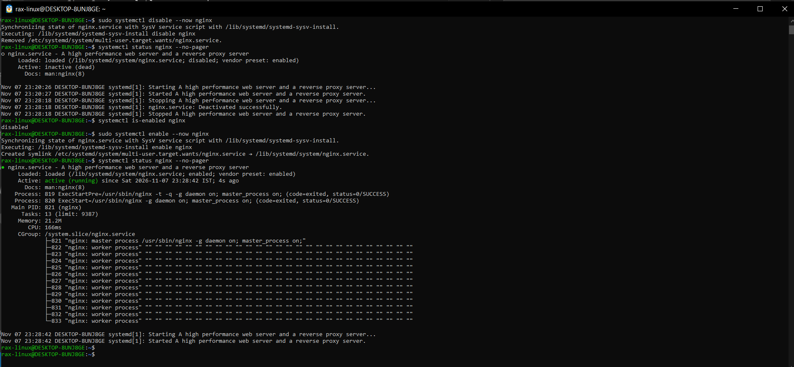
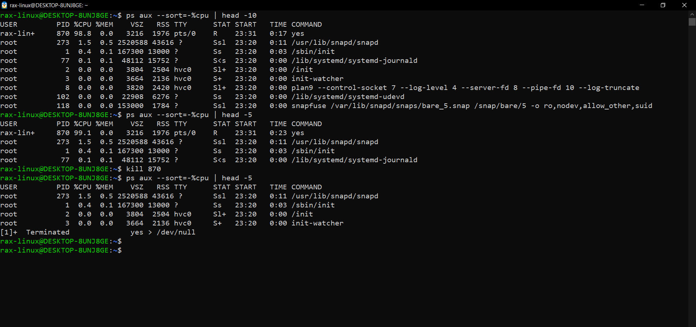
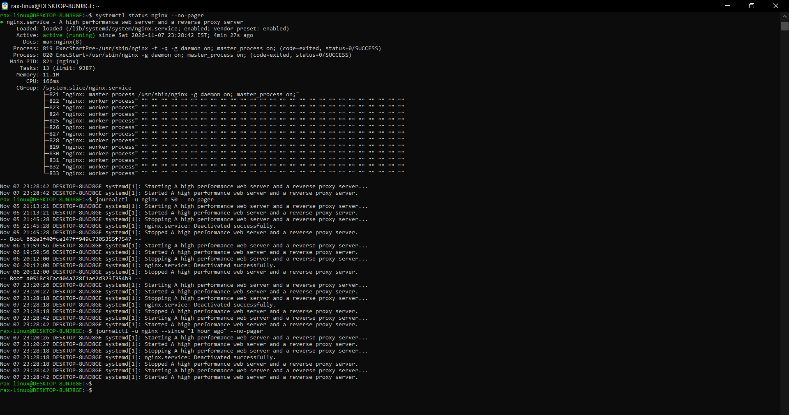
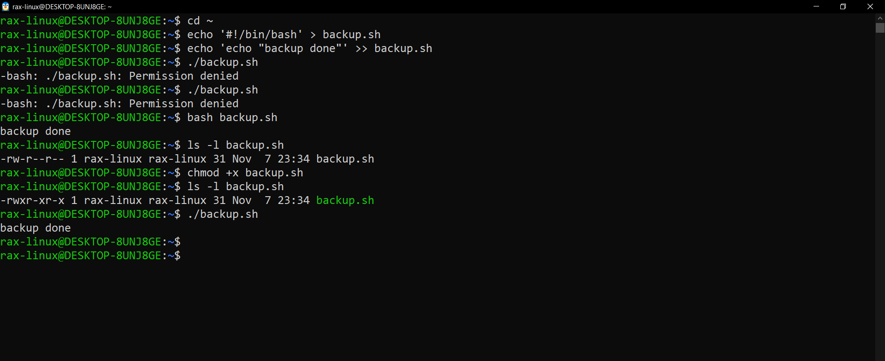

# Linux File System and Scenarios (Day 07)

Ubuntu 22.04 on WSL2.

---

# Part 1: Linux File System

In Linux everything starts from `/`. There is no C: or D: drive like Windows, all folders and disks are somewhere inside `/`.

## `/` (root)

This is the top folder, all other folders are inside it.
I would use this when I login to a new server and want to see how it is set up.

```bash
ls -l /
ls -ld / /home /root /etc /var/log /tmp /bin /usr/bin /opt
```

`ls -ld` shows the folder itself, not what's inside. So I can see the permissions of all 9 folders at once.



- What I saw: bin, lib and sbin are just links to usr/bin, usr/lib and usr/sbin. /root is drwx------ (only root can open it) and /tmp has a t at the end.
- Why: one command shows me how the whole system is laid out and who can open what.
- Careful: never run `rm -rf` with `/` anywhere near it, one typo can delete the whole system.

## `/home`, `/root` and `~`

`/home` has a folder for every normal user. My files are in `/home/rax-linux`.
`/root` is the home folder of the root user. I can't open it without sudo.
`~` is just a short way to write my home folder.
I would use this when I need to find a user's files or scripts.

```bash
ls -l /home
sudo ls -l /root
ls -la ~
```



- What I saw: /home has only my user. /root only has a snap folder. My home has hidden files like .bashrc, .bash_history and .ssh, plus day03-practice from Day 3.
- Why: to know where my own files are. My home is drwxr-x---, so other users can't look inside it.
- Careful: .ssh keeps the private keys, never share or screenshot what's inside it.

## `/etc`

All config files are here, for the system and for apps like nginx.
I would use this when I want to change or check the settings of a service.

```bash
ls -l /etc | head -15
cat /etc/hostname
ls -l /etc/nginx
```



- What I saw: /etc has a lot of config files like adduser.conf and bash.bashrc. hostname is DESKTOP-8UNJ8GE. /etc/nginx has nginx.conf and sites-available from my Day 5 install.
- Why: every service reads its settings from /etc, so this is where I check or change a config.
- Careful: take a backup before editing anything here (`cp nginx.conf nginx.conf.bak`) and test it with `nginx -t` before reload.

## `/var/log`

All the log files. This is the first place to look when something breaks.
I would use this when a service fails and I want to know why.

```bash
ls -l /var/log
sudo du -sh /var/log/* 2>/dev/null | sort -h | tail -5
```



- What I saw: auth.log, syslog, kern.log and an nginx folder. The red .gz files are old logs that got compressed. Biggest one is journal with 313M.
- Why: logs tell me what happened, and du shows what is eating the disk.
- Careful: syslog and auth.log are -rw-r----- so I need sudo to read them. Don't delete logs by hand, use `journalctl --vacuum-size` to clean the journal.

## `/tmp` and `/opt`

`/tmp` is for temporary files. Anyone can write here and it gets cleaned after reboot.
`/opt` is for extra software that I install myself, not from apt.
I would use `/tmp` for quick test files and `/opt` when I install some outside app.

```bash
ls -l /tmp
ls -l /opt
```



- What I saw: /tmp only has some systemd-private folders owned by root. /opt is empty (total 0), I haven't installed anything there yet.
- Why: /tmp is good for quick tests, and /opt tells me if someone installed software by hand.
- Careful: never keep anything important in /tmp, it's gone after a reboot.

## `/bin` and `/usr/bin`

The real programs behind commands like `ls`, `cat` and `bash` are kept here.
I would use this when I want to check if a command is installed and where it is.

```bash
ls -ld /bin
ls -l /usr/bin | head -10
which ls cat nginx
```



- What I saw: /bin is just a link to usr/bin. Even `[` is a program in /usr/bin. ls and cat are in /usr/bin but nginx is in /usr/sbin (sbin is for admin programs).
- Why: `which` tells me if a command is installed and which program actually runs.
- Careful: never delete or replace files here by hand, always use apt, or commands will break.

## Few more I should know

- `/var/lib` - apps keep their data here, like docker images. If disk is full and /var/log is small, check this.
- `/proc` - not real files, it shows live info from the system like `/proc/cpuinfo`
- `/run` - PID files and sockets, gets cleaned on every reboot

---

# Part 2: Scenarios

## Scenario 1: Service not starting after reboot

`myapp` did not start after the server rebooted.

```
Step 1: systemctl status myapp
Why: to see if it's failed or just stopped, it also shows last few logs

Step 2: journalctl -u myapp -b -p err --no-pager
Why: shows only the errors after the last boot

Step 3: systemctl is-enabled myapp
Why: if it says disabled, it will never start on boot. this is a very common reason

Step 4: systemctl cat myapp
Why: to check the service file, like which command it runs

Step 5: sudo systemctl enable --now myapp
Why: enables it for boot and starts it right now. then check status again
```

I don't have any `myapp`, so I tried the same thing with nginx. I disabled and stopped it, so it looks like it didn't come up after reboot:

```bash
sudo systemctl disable --now nginx
systemctl status nginx --no-pager
systemctl is-enabled nginx
sudo systemctl enable --now nginx
systemctl status nginx --no-pager
```



- What I saw: disable removed the link from multi-user.target.wants and nginx went inactive (dead). After enable --now the link came back and nginx was active again with a new PID 821.
- Why: it shows the difference between stopped and disabled. Disabled means it won't come back after a reboot.
- Careful: `disable --now` stops it right away. On a real server that means the site goes down, so I only did this on my practice machine.

## Scenario 2: High CPU

Server is slow, need to find which process is eating the CPU.

```
Step 1: top
Why: live view. press P to sort by CPU and see the PID on top

Step 2: ps aux --sort=-%cpu | head -10
Why: same thing but as a list, easy to copy

Step 3: ps -o pid,ppid,etime,pcpu,cmd -p <PID>
Why: to see what this process is and how long it's running

Step 4: vmstat 1 5
Why: if "us" is high the CPU is really busy, if "wa" is high it's waiting on the disk

Step 5: kill <PID> or restart the service
Why: to fix it. then check ps again
```

I made a fake CPU eater with `yes` and tried it:

```bash
yes > /dev/null &
ps aux --sort=-%cpu | head -10
ps aux --sort=-%cpu | head -5
kill 870
ps aux --sort=-%cpu | head -5
```



- What I saw: yes was on top with PID 870 at 98.8% CPU. After `kill 870` it was gone from the list and showed Terminated.
- Why: ps sorted by CPU finds the problem process and its PID in a few seconds.
- Careful: first check what the process is before killing it. Killing the wrong one, like a database, can make things worse. Try `kill` before `kill -9`.

## Scenario 3: Where are the docker logs

A developer is asking where the logs of `docker` are.

```
Step 1: systemctl status docker
Why: first check the service is there and running

Step 2: journalctl -u docker -n 50
Why: systemd services save logs in journald. -n 50 gives last 50 lines

Step 3: journalctl -u docker -f
Why: to watch new logs live, same like tail -f

Step 4: journalctl -u docker --since "1 hour ago" -p warning
Why: only warnings and errors from the last 1 hour
```

Docker is not installed on my laptop yet, so I did it with nginx:

```bash
systemctl status nginx --no-pager
journalctl -u nginx -n 50 --no-pager
journalctl -u nginx --since "1 hour ago" --no-pager
```



- What I saw: -n 50 showed nginx logs from 3 different boots (Nov 5, 6 and 7). `--since "1 hour ago"` showed only today, including my stop at 23:28:18 and start at 23:28:42 from scenario 1.
- Why: `journalctl -u` gives the logs of just one service, and `--since` cuts it down to the time of the problem.
- Careful: `-f` keeps running until Ctrl+C. Also logs can have IPs or usernames, so check before sharing them.

## Scenario 4: Permission denied on a script

Running `./backup.sh` gives "Permission denied".

```
Step 1: ls -l backup.sh
Why: to check permissions. if there is no x, it can't run

Step 2: chmod +x backup.sh
Why: gives it run permission

Step 3: ls -l backup.sh
Why: to make sure x is added now

Step 4: ./backup.sh
Why: run it again
```

I made a real `backup.sh` in my home folder. I did it in `~` and not in my Windows drive, because on the Windows drive every file shows rwx so I won't get the error.

```bash
cd ~
echo '#!/bin/bash' > backup.sh
echo 'echo "backup done"' >> backup.sh
./backup.sh
bash backup.sh
ls -l backup.sh
chmod +x backup.sh
ls -l backup.sh
./backup.sh
```



- What I saw: `./backup.sh` gave Permission denied but `bash backup.sh` worked. The file was -rw-r--r--, after `chmod +x` it became -rwxr-xr-x, the name turned green and it ran.
- Why: this error is very common after copying a script or a git clone. ls -l and chmod +x fix it in seconds.
- Careful: don't use `chmod 777` to fix it, that gives everyone write access too. `+x` is enough.

If `chmod +x` still doesn't work:
- try `bash backup.sh`. it runs even without x, so if this works the problem was the permission only
- `namei -l /path/to/backup.sh` shows permissions of every folder in the path. a folder without x can also give permission denied
- `bad interpreter: /bin/bash^M` means the file was saved on Windows. fix it with `sed -i 's/\r$//' backup.sh`
