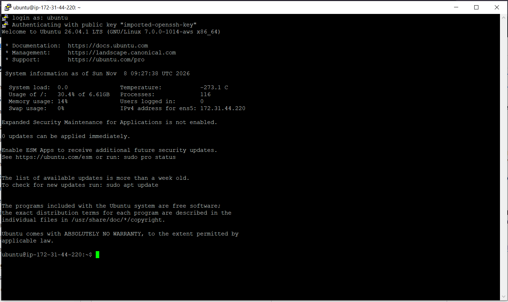
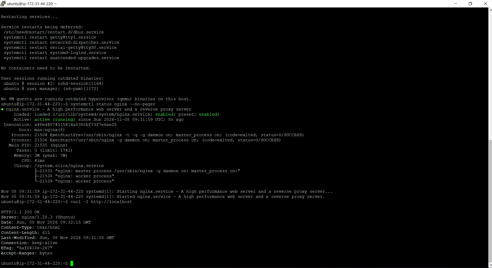
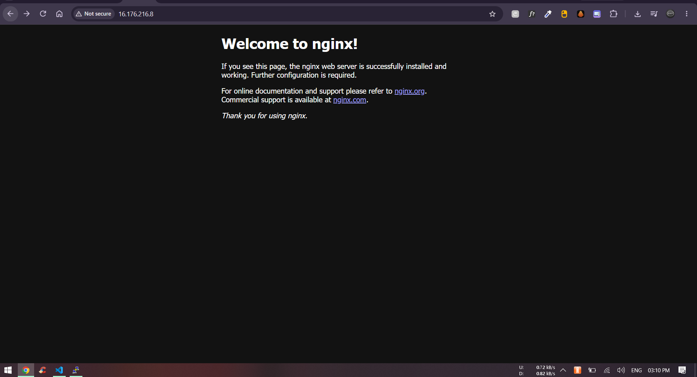
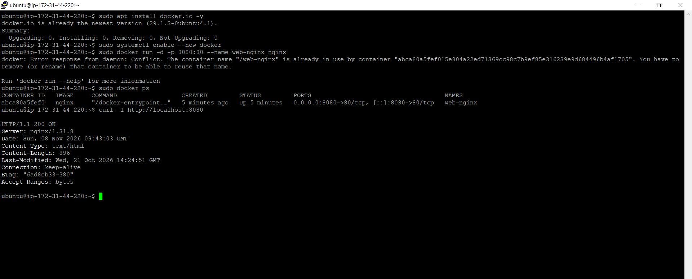
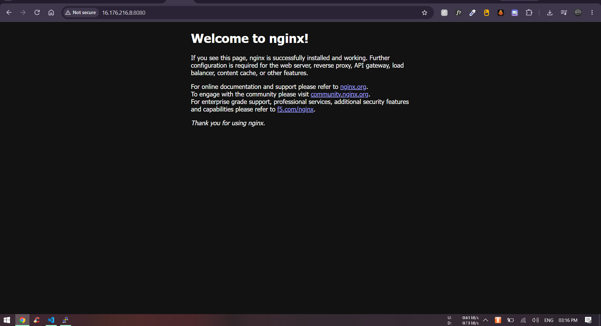
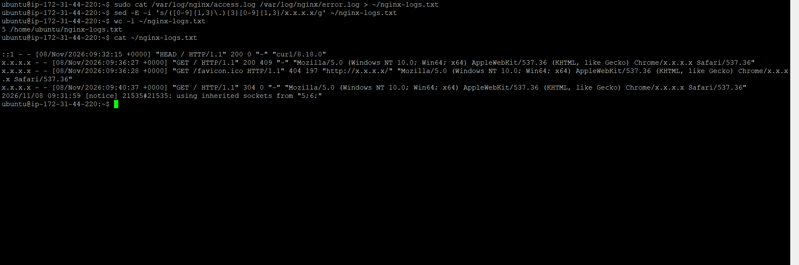

# Cloud Server Setup (Day 08)

Today I launched a real server on AWS, connected to it with SSH, installed nginx and opened my web page from the internet.

- Cloud: AWS EC2 (Sydney region)
- Server: Ubuntu 26.04.1 LTS, free tier instance
- My laptop: Windows, connected with PuTTY

---

## 1. Launch the server

In the AWS console: EC2 > Launch instance

- OS: Ubuntu
- Type: free tier (t2.micro / t3.micro)
- Key pair: created a new `.pem` key
- Security group:
  - SSH (22) - only from **My IP**
  - HTTP (80) - from anywhere

I opened SSH only for my IP, so nobody else on the internet can even try to login.

---

## 2. Connect with SSH

PuTTY doesn't read `.pem` keys, it needs `.ppk`, so first I converted it:

1. Opened **PuTTYgen** > Load > changed file type to "All Files" > picked the `.pem` key
2. Clicked **Save private key** > saved it as `.ppk`

Then in **PuTTY**:

- Session > Host Name: `ubuntu@<public-ip>`, Port 22, SSH
- Connection > SSH > Auth > Credentials > Private key file: the `.ppk` file
- Open > Accept the server's key



PuTTY logged me in with my key, no password. The server is Ubuntu 26.04.1 and its private IP is 172.31.44.220.
That private IP only works inside AWS, from my browser I have to use the public IP.

---

## 3. Install nginx

```bash
sudo apt update
sudo apt upgrade
sudo apt install nginx -y
systemctl status nginx --no-pager
curl -I http://localhost
```



nginx 1.28.3 got installed, it's active (running) and enabled, with 1 master and 2 workers.
`curl -I http://localhost` gave `200 OK`, so nginx is working inside the server.

Then I opened `http://<public-ip>` in my browser:



The nginx welcome page opened from the internet, on my server's public IP.
Chrome shows "Not secure" because it's plain http on port 80, there is no SSL yet.

---

## 4. Docker + nginx

Same nginx, but this time inside a Docker container. Port 80 is already used by the nginx I installed, so I gave the container port 8080.

```bash
sudo apt install docker.io -y
sudo systemctl enable --now docker
sudo docker run -d -p 8080:80 --name web-nginx nginx
sudo docker ps
curl -I http://localhost:8080
sudo docker logs web-nginx
```



Running `docker run` again gave a `Conflict` error, because a container named web-nginx was already running. `docker ps` showed it Up with `0.0.0.0:8080->80/tcp`.
curl on port 8080 gave `200 OK` from nginx/1.31.8, a newer version than the 1.28.3 on port 80.

To open it in the browser I added one more inbound rule in the security group: Custom TCP, port 8080, source **My IP**.



`http://<public-ip>:8080` opened the nginx page from the container. The text is different from the port 80 page, because it's a different nginx version.
So now one server is running two nginx at the same time, one installed with apt and one in Docker.

---

## 5. Save the logs

```bash
sudo tail -n 20 /var/log/nginx/access.log
sudo tail -n 20 /var/log/nginx/error.log
sudo cat /var/log/nginx/access.log /var/log/nginx/error.log > ~/nginx-logs.txt
sed -E -i 's/([0-9]{1,3}\.){3}[0-9]{1,3}/x.x.x.x/g' ~/nginx-logs.txt
wc -l ~/nginx-logs.txt
cat ~/nginx-logs.txt
```

The access log has the IP of everyone who opened the page, my home IP too. So the `sed` line replaces every IP with `x.x.x.x` before I save or share the file.



5 lines: my curl (`::1` is localhost in IPv6), my browser visit (`200`), the browser asking for a tab icon (`404`, normal, there is no icon) and a refresh (`304`, page not changed so the browser used its cache).
error.log has only one notice, no real errors.

Then I downloaded the file to my laptop with `pscp`, which comes with PuTTY. This runs in Windows Command Prompt, not on the server:

```bat
cd /d "S:\Devops Training\90DaysOfDevOps\2026\day-08"
pscp -i "C:\path\to\key.ppk" ubuntu@<public-ip>:/home/ubuntu/nginx-logs.txt .
```

---

## 6. Clean up

So AWS doesn't charge me later:

- EC2 > Instances > select the instance > Instance state > **Terminate**
- this also removes the Docker container and the security group rules with it

---

## Commands Used

```bash
sudo apt update
sudo apt install nginx -y
systemctl status nginx --no-pager
curl -I http://localhost
sudo apt install docker.io -y
sudo systemctl enable --now docker
sudo docker run -d -p 8080:80 --name web-nginx nginx
sudo docker ps
sudo docker logs web-nginx
sudo tail -n 20 /var/log/nginx/access.log
sudo cat /var/log/nginx/access.log /var/log/nginx/error.log > ~/nginx-logs.txt
sed -E -i 's/([0-9]{1,3}\.){3}[0-9]{1,3}/x.x.x.x/g' ~/nginx-logs.txt
pscp -i key.ppk ubuntu@<public-ip>:/home/ubuntu/nginx-logs.txt .
```

## Challenges Faced

1. **PuTTY didn't take my .pem key**
   PuTTY only reads `.ppk` keys. I converted the `.pem` to `.ppk` with PuTTYgen and then it logged in.

2. **The page didn't open in the browser at first**
   `curl http://localhost` on the server gave `200 OK`, so nginx was fine and the request just wasn't reaching the server. I checked the security group (HTTP 80 open to everyone), typed `http://` myself so Chrome doesn't switch to https, and used the public IP, not the private one. After that the page opened.

3. **Docker said the container name is already in use**
   I ran `docker run` again with the same name `web-nginx`. Docker doesn't allow two containers with the same name. It was already running, so I just checked it with `docker ps`. To start it fresh, first remove it with `docker rm -f web-nginx`.

4. **Port 8080 didn't open from outside**
   The Docker nginx was working on the server but not from my browser. Port 8080 was not in the security group, so I added it, only for My IP.

5. **My home IP was in the logs**
   The access log and even the "Last login" message on SSH show my home IP. I hid it with `sed` before saving the log file, and didn't use any screenshot that shows it.

## What I Learned

- If `curl localhost` works but the browser doesn't, the problem is outside the server, like the security group, not nginx
- The security group is the firewall of AWS. Open only what is needed: SSH only for my IP, port 80 for everyone
- A Docker container has its own OS (the log said Debian, my server is Ubuntu) but uses the same kernel as the server
- Two apps can't use the same port, that's why Docker nginx is on 8080 and the normal one on 80
- Logs keep the IP of every visitor, so always check before sharing logs or screenshots
