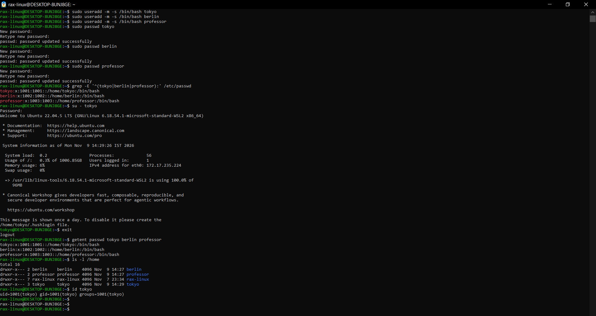
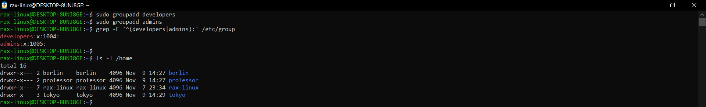
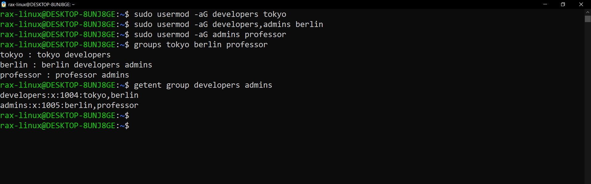
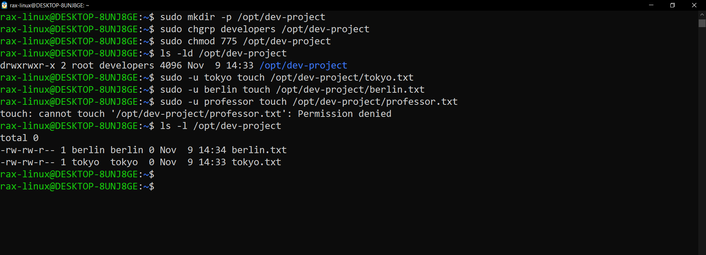
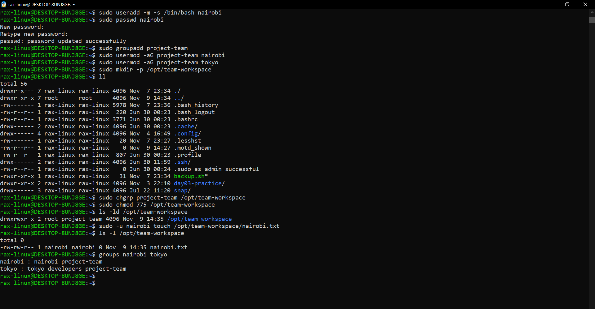
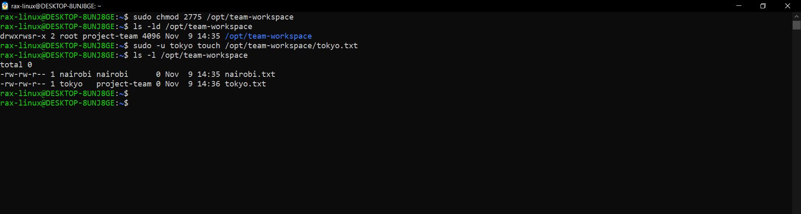
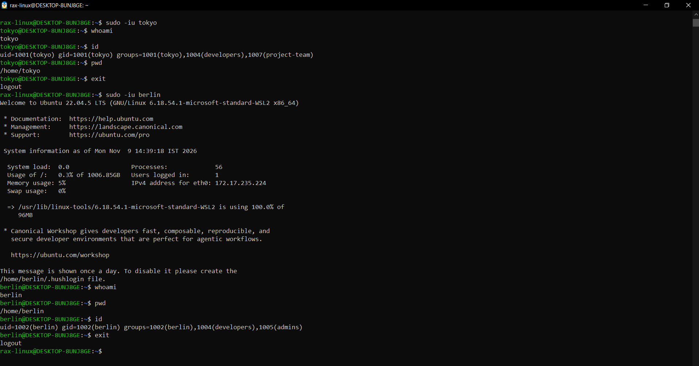
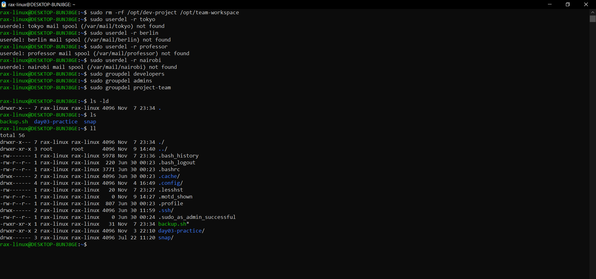

# User and Group Management (Day 09)

Ubuntu 22.04 on WSL2. Almost every command needs `sudo` because only root can add users and groups.

---

## Task 1: Create users

```bash
sudo useradd -m -s /bin/bash tokyo
sudo useradd -m -s /bin/bash berlin
sudo useradd -m -s /bin/bash professor
sudo passwd tokyo
sudo passwd berlin
sudo passwd professor
grep -E '^(tokyo|berlin|professor):' /etc/passwd
su - tokyo
getent passwd tokyo berlin professor
ls -l /home
id tokyo
```

Why I used these:
- `useradd` - makes the new user. `-m` also makes their home folder in /home, and `-s /bin/bash` gives them bash, otherwise Ubuntu gives the old `/bin/sh`
- `passwd` - sets the password, without it the user can't login
- `grep -E '^(tokyo|berlin|professor):' /etc/passwd` - shows only the lines of my 3 users from the users file. `^` means the line starts with the name and `|` means "or"
- `su - tokyo` - login as tokyo with the password, just to check the password really works
- `getent passwd` - same result as the grep, but simpler to type
- `ls -l /home` - to see that every user got their own home folder
- `id tokyo` - shows the user id and which groups tokyo is in

A line in /etc/passwd looks like `tokyo:x:1001:1001::/home/tokyo:/bin/bash`
- name : x : user id : group id : (empty) : home folder : shell
- the `x` means the password is not here, it's saved in `/etc/shadow` which only root can read



The 3 users got ids 1001, 1002 and 1003, each with their own home folder and bash. `su - tokyo` logged in with the password, so passwd worked.
Every home folder is `drwxr-x---`, so other users can't look inside. Right now `id tokyo` shows only one group, tokyo.

---

## Task 2: Create groups

```bash
sudo groupadd developers
sudo groupadd admins
grep -E '^(developers|admins):' /etc/group
ls -l /home
```

Why I used these:
- `groupadd` - makes a new group
- `grep ... /etc/group` - /etc/group is the file with all the groups, this shows only my 2 new ones



developers got group id 1004 and admins got 1005. The end of the line is empty because no one is in these groups yet.

---

## Task 3: Add users to groups

```bash
sudo usermod -aG developers tokyo
sudo usermod -aG developers,admins berlin
sudo usermod -aG admins professor
groups tokyo berlin professor
getent group developers admins
```

Why I used these:
- `usermod -aG` - adds a user to a group. `-G` is the group and `-a` means add. Without `-a`, the user gets removed from all their other groups first
- `developers,admins` - a comma adds berlin to both groups in one command
- `groups` - shows which groups each user is in
- `getent group` - shows it the other way round, which users are in each group



tokyo is in developers, berlin is in both, professor is in admins. Exactly what the task asked.
`getent` shows the same from the group side: developers has tokyo and berlin, admins has berlin and professor.

---

## Task 4: Shared folder for developers

```bash
sudo mkdir -p /opt/dev-project
sudo chgrp developers /opt/dev-project
sudo chmod 775 /opt/dev-project
ls -ld /opt/dev-project
sudo -u tokyo touch /opt/dev-project/tokyo.txt
sudo -u berlin touch /opt/dev-project/berlin.txt
sudo -u professor touch /opt/dev-project/professor.txt
ls -l /opt/dev-project
```

Why I used these:
- `mkdir -p` - makes the folder. I used /opt because it's for things I set up myself (Day 7)
- `chgrp developers` - changes the group of the folder to developers, so this group gets the group permissions
- `chmod 775` - owner and group can read, write and open it (7 = rwx), everyone else can only read and open it (5 = r-x)
- `ls -ld` - shows the permissions of the folder itself
- `sudo -u tokyo touch ...` - runs touch as tokyo, so I can test without logging in as tokyo
- the professor test is on purpose. professor is not in developers, so it should fail



The folder is `drwxrwxr-x root developers`. tokyo and berlin made their files, professor got Permission denied, so the group permission works.
But tokyo.txt belongs to group tokyo, not developers. So berlin can't edit tokyo's file even though both are in developers. Task 5 has the fix for this.

---

## Task 5: Team workspace

```bash
sudo useradd -m -s /bin/bash nairobi
sudo passwd nairobi
sudo groupadd project-team
sudo usermod -aG project-team nairobi
sudo usermod -aG project-team tokyo
sudo mkdir -p /opt/team-workspace
sudo chgrp project-team /opt/team-workspace
sudo chmod 775 /opt/team-workspace
ls -ld /opt/team-workspace
sudo -u nairobi touch /opt/team-workspace/nairobi.txt
ls -l /opt/team-workspace
groups nairobi tokyo
```

Why I used these: same steps as task 1 to 4, just for a new team. A user can be in many groups, so tokyo is now in developers and project-team.



The folder is `drwxrwxr-x root project-team` and nairobi could make a file in it.
tokyo is now in 3 groups: tokyo, developers and project-team. (I also ran `ll` by mistake in my home folder, you can ignore that part.)

### Fix: new files should get the folder's group (setgid)

```bash
sudo chmod 2775 /opt/team-workspace
ls -ld /opt/team-workspace
sudo -u tokyo touch /opt/team-workspace/tokyo.txt
ls -l /opt/team-workspace
```

Why I used these:
- `chmod 2775` - same 775, the extra `2` in front is setgid. It makes every new file in this folder get the folder's group
- the `touch` as tokyo is to check if the new file really gets project-team



`ls -ld` now shows `drwxrwsr-x`, the `s` is the setgid. tokyo.txt got group project-team, so everyone in the team can work on it.
The old nairobi.txt still has group nairobi, setgid only works for new files.

---

## Extra: login as the new users

```bash
sudo -iu tokyo
whoami
id
pwd
exit
sudo -iu berlin
whoami
pwd
id
exit
```

Why I used these:
- `sudo -iu` - full login as that user. `sudo -u` only runs one command, this is like the user really logged in
- `whoami` - which user am I right now
- `id` - my user id and all my groups
- `pwd` - where I am, a real login should start in the user's own home



As tokyo: home is /home/tokyo and the groups are tokyo, developers (1004) and project-team (1007).
As berlin: home is /home/berlin and the groups are berlin, developers and admins. Both match what I set up.

---

## Clean up

```bash
sudo rm -rf /opt/dev-project /opt/team-workspace
sudo userdel -r tokyo
sudo userdel -r berlin
sudo userdel -r professor
sudo userdel -r nairobi
sudo groupdel developers
sudo groupdel admins
sudo groupdel project-team
ls
ll
```

Why I used these:
- `rm -rf` - deletes both practice folders with everything in them
- `userdel -r` - deletes the user, `-r` also deletes their home folder
- `groupdel` - deletes the group. Users go first, because a group can't be deleted while it's someone's main group



Everything got removed without errors. The `mail spool not found` lines are normal, these users never got any mail so there was nothing to delete.

---

## Users & Groups Created

- Users: tokyo, berlin, professor, nairobi
- Groups: developers, admins, project-team

## Group Assignments

| User | Groups |
|---|---|
| tokyo | developers, project-team |
| berlin | developers, admins |
| professor | admins |
| nairobi | project-team |

## Directories Created

| Directory | Group | Permissions |
|---|---|---|
| /opt/dev-project | developers | 775 (drwxrwxr-x) |
| /opt/team-workspace | project-team | 775 (drwxrwxr-x), then 2775 (drwxrwsr-x) for setgid |

## Commands Used

```bash
useradd -m -s /bin/bash <user>
passwd <user>
groupadd <group>
usermod -aG <group> <user>
groups <user>
id <user>
getent passwd <user>
getent group <group>
mkdir -p <dir>
chgrp <group> <dir>
chmod 775 <dir>
chmod 2775 <dir>
ls -ld <dir>
sudo -u <user> touch <file>
sudo -iu <user>
userdel -r <user>
groupdel <group>
```

## What I Learned

- Always use `usermod -aG`, not just `-G`. Without `-a` the user gets removed from all their other groups
- Giving a folder to a group (chgrp + chmod 775) lets a whole team work in it, and anyone outside the team gets Permission denied
- A new file gets the group of the user who made it, not of the folder. setgid (`chmod 2775`) fixes this, so shared folders really stay shared
- In real DevOps work this is how teams get access on a server: one group per team, and folders owned by that group, instead of giving everyone sudo
