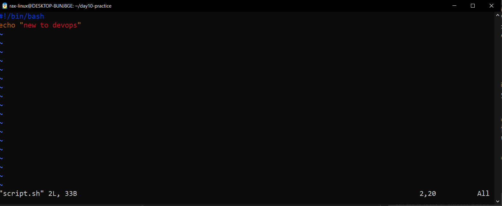
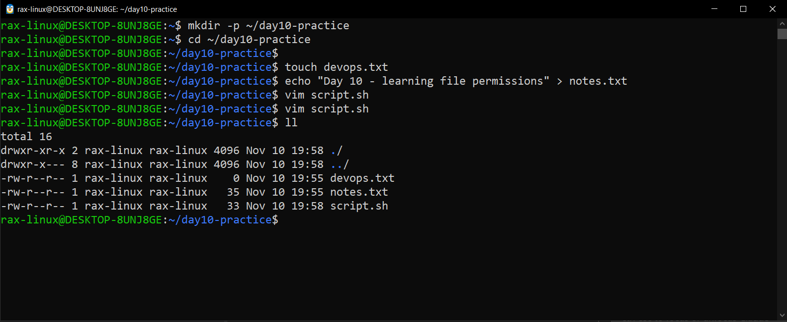
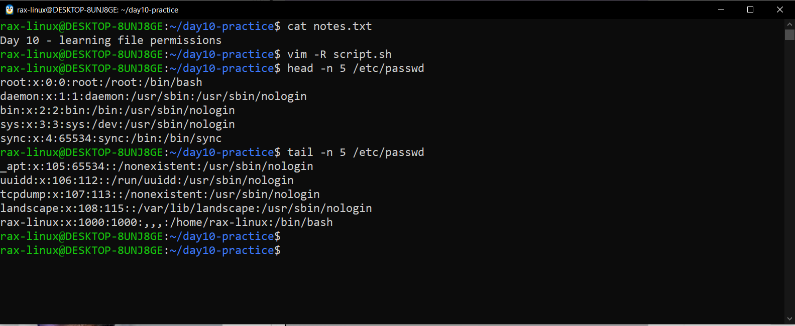
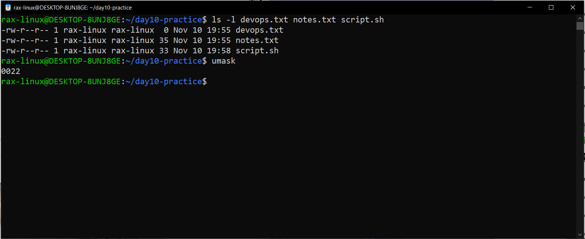
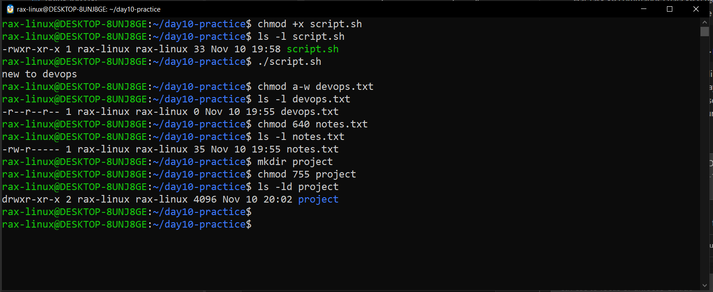
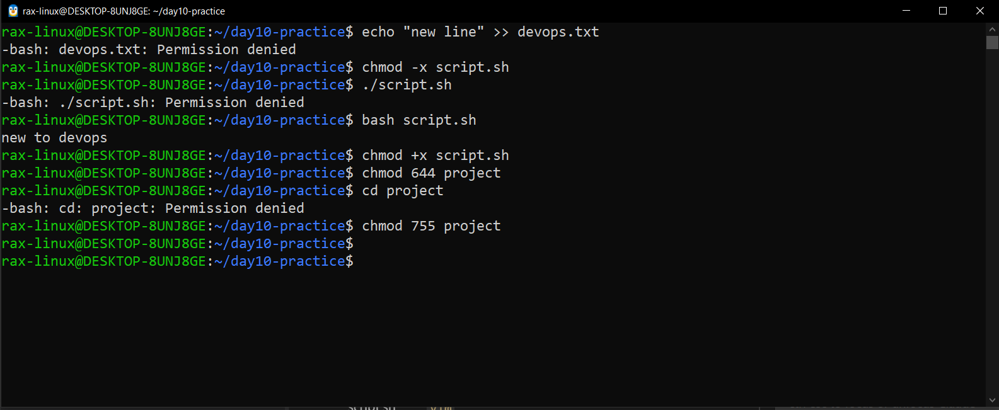

# File Permissions (Day 10)

Ubuntu 22.04 on WSL2. I did this in my home folder and not on the Windows drive, because on the Windows drive every file shows `rwx` and permissions don't really work there (I saw this on Day 6).

---

## Task 1: Create files

```bash
mkdir -p ~/day10-practice
cd ~/day10-practice
touch devops.txt
echo "Day 10 - learning file permissions" > notes.txt
vim script.sh
ll
```

Why I used these:
- `mkdir -p` + `cd` - a clean practice folder, so `ls` only shows my Day 10 files
- `touch` - makes an empty file
- `echo "..." >` - makes a file and writes a line into it in one go (Day 6)
- `vim` - opens the editor to write the script

In vim I pressed `i` to start typing, wrote these 2 lines, then `Esc` and `:wq` to save and exit:

```bash
#!/bin/bash
echo "new to devops"
```

The first line `#!/bin/bash` tells Linux to run this file with bash.



The bottom of vim shows `"script.sh" 2L, 33B`, so the file got saved with 2 lines.
(The task said `echo "Hello DevOps"`, I wrote my own message instead, it works the same way.)



All 3 files got `-rw-r--r--`. devops.txt is 0 bytes because touch makes an empty file.
The folder itself got `drwxr-xr-x`, so files and folders don't start with the same permissions.

---

## Task 2: Read files

```bash
cat notes.txt
vim -R script.sh
head -n 5 /etc/passwd
tail -n 5 /etc/passwd
```

Why I used these:
- `cat` - prints the whole file, good for small files
- `vim -R` - opens the file read-only, so I can look but not change it by mistake. `:q` to exit
- `head -n 5` / `tail -n 5` - only the first or last 5 lines, good for big files like logs



head shows root first, with user id 0. That 0 is how Linux knows root is the admin.
tail shows system users like `_apt` and `tcpdump` with `/usr/sbin/nologin` (no one can login as them, they only run services), and my own user rax-linux with id 1000 at the end.

---

## Task 3: Understand permissions

```bash
ls -l devops.txt notes.txt script.sh
umask
```

Why I used these:
- `ls -l` - shows the permissions of my 3 files
- `umask` - shows why new files get these permissions

`-rw-r--r--` is split like this:

| - | rw- | r-- | r-- |
|---|---|---|---|
| file type (`-` file, `d` folder) | owner | group | others |

| Letter | Means | Number |
|---|---|---|
| r | read | 4 |
| w | write | 2 |
| x | execute (run) | 1 |
| - | not allowed | 0 |

Add the numbers for each part: rw- = 4+2 = 6, r-- = 4, so `rw-r--r--` = 644.



All 3 files are 644: I (the owner) can read and write, my group and everyone else can only read. No one can execute, not even script.sh.
umask is `0022`. New files start at 666 and umask takes away write from group and others, so they end up 644. Folders start at 777 and end up 755. Files never get x on their own, that's why script.sh needs chmod +x.

The ones I'll see the most:

| Number | Looks like | Used for |
|---|---|---|
| 600 | `-rw-------` | private files like SSH keys |
| 644 | `-rw-r--r--` | normal files and configs |
| 640 | `-rw-r-----` | owner and group can read, others can't |
| 755 | `-rwxr-xr-x` | scripts and normal folders |
| 775 | `drwxrwxr-x` | shared team folder (Day 9) |
| 777 | `-rwxrwxrwx` | everyone can do everything, almost always a mistake |

---

## Task 4: Change permissions

```bash
chmod +x script.sh
ls -l script.sh
./script.sh

chmod a-w devops.txt
ls -l devops.txt

chmod 640 notes.txt
ls -l notes.txt

mkdir project
chmod 755 project
ls -ld project
```

Why I used these:
- `chmod +x` - adds execute, so the script can run
- `chmod a-w` - removes write from all. In letters: `u` = owner, `g` = group, `o` = others, `a` = all of them, `+` adds and `-` removes
- `chmod 640` - owner rw (6), group r (4), others nothing (0)
- `chmod 755` - owner rwx (7), group and others r-x (5). On a folder, x means you can open it with cd
- `ls -l` / `ls -ld` after every change - to check it really changed. `-d` shows the folder itself, not what's inside



script.sh became `-rwxr-xr-x`, turned green and printed "new to devops". devops.txt became `-r--r--r--`, read-only for everyone.
notes.txt became `-rw-r-----`, others can't even read it now. project is `drwxr-xr-x`.

---

## Task 5: Test permissions

```bash
echo "new line" >> devops.txt
chmod -x script.sh
./script.sh
bash script.sh
chmod +x script.sh
chmod 644 project
cd project
chmod 755 project
```

Why I used these:
- `echo >>` on devops.txt - trying to write to a read-only file
- `chmod -x` then `./script.sh` - trying to run a file without execute
- `bash script.sh` - runs it anyway, because here bash is the program that runs and it only needs to read the file (same as Day 7)
- `chmod 644 project` then `cd` - a folder without x, to see if I can still go inside
- the last `chmod +x` and `chmod 755` - putting everything back



All 3 tries failed with Permission denied, like they should. `bash script.sh` still printed "new to devops".
So on a file x means "can run it", and on a folder x means "can go inside it".

The errors I got:

| What I tried | Error | Why |
|---|---|---|
| `echo >> devops.txt` | `-bash: devops.txt: Permission denied` | no w on the file |
| `./script.sh` without x | `-bash: ./script.sh: Permission denied` | no x on the file |
| `cd project` without x | `-bash: cd: project: Permission denied` | no x on the folder |

---

## Files Created

| File | How |
|---|---|
| devops.txt | `touch` (empty file) |
| notes.txt | `echo "..." >` |
| script.sh | `vim` |
| project/ | `mkdir` |

## Permission Changes

| File | Before | Command | After |
|---|---|---|---|
| script.sh | `-rw-r--r--` (644) | `chmod +x` | `-rwxr-xr-x` (755) |
| devops.txt | `-rw-r--r--` (644) | `chmod a-w` | `-r--r--r--` (444) |
| notes.txt | `-rw-r--r--` (644) | `chmod 640` | `-rw-r-----` (640) |
| project/ | `drwxr-xr-x` (755) | `chmod 755` | `drwxr-xr-x` (755) |

## Commands Used

| Command | What it does |
|---|---|
| `mkdir -p ~/day10-practice` | makes a practice folder in my home |
| `cd ~/day10-practice` | goes inside that folder |
| `touch devops.txt` | makes an empty file |
| `echo "..." > notes.txt` | makes a file and writes one line in it |
| `vim script.sh` | opens the editor to write the script (`i` to type, `Esc` then `:wq` to save) |
| `ll` | lists all files with their permissions |
| `cat notes.txt` | prints the whole file |
| `vim -R script.sh` | opens the file read-only, `:q` to exit |
| `head -n 5 /etc/passwd` | shows the first 5 lines of the file |
| `tail -n 5 /etc/passwd` | shows the last 5 lines of the file |
| `ls -l <file>` | shows the permissions of a file |
| `ls -ld project` | shows the permissions of the folder itself, not what's inside |
| `umask` | shows the default rule for new file permissions (0022) |
| `chmod +x script.sh` | adds execute, so the script can run |
| `./script.sh` | runs the script from the current folder |
| `chmod a-w devops.txt` | removes write for everyone, file becomes read-only |
| `chmod 640 notes.txt` | owner rw, group r, others nothing |
| `mkdir project` | makes a new folder |
| `chmod 755 project` | owner rwx, group and others r-x |
| `echo "new line" >> devops.txt` | tries to add a line to the read-only file (fails) |
| `chmod -x script.sh` | removes execute from the script |
| `bash script.sh` | runs the script with bash, works even without x |
| `chmod 644 project` | removes x from the folder |
| `cd project` | tries to go inside the folder without x (fails) |

## What I Learned

- r = 4, w = 2, x = 1. Add them up for owner, group and others and you get numbers like 644 or 755
- New files never get x on their own (umask 0022 gives 644), so every script needs `chmod +x` before `./script.sh` works
- x means different things: on a file it's "can run it", on a folder it's "can go inside it"
- Permission denied is not a bug, it's Linux protecting the file. First check `ls -l`, then fix the one permission that's missing, never just `chmod 777`
