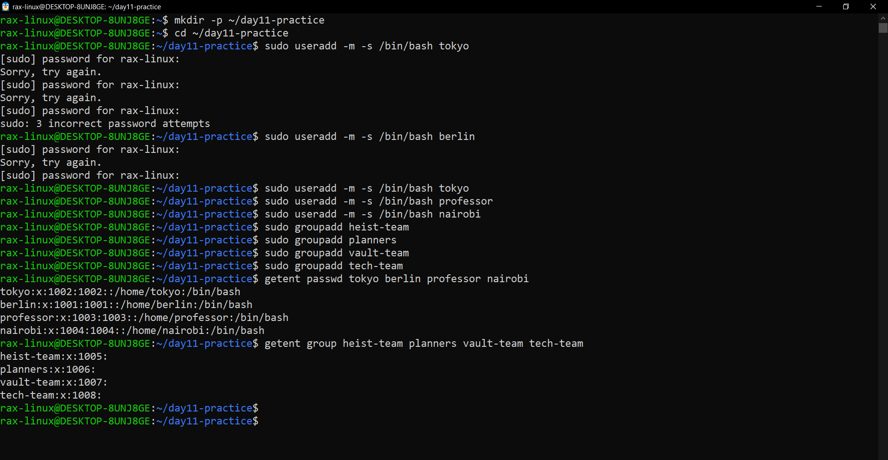
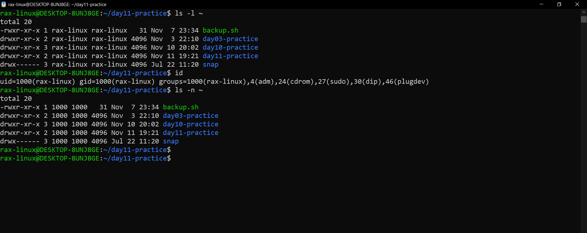
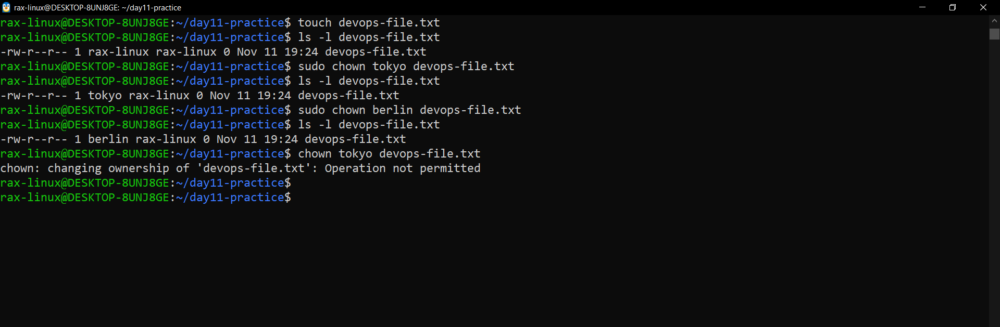
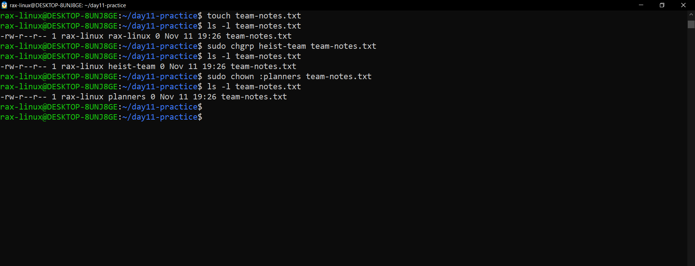
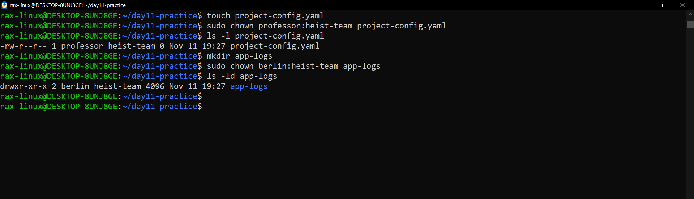
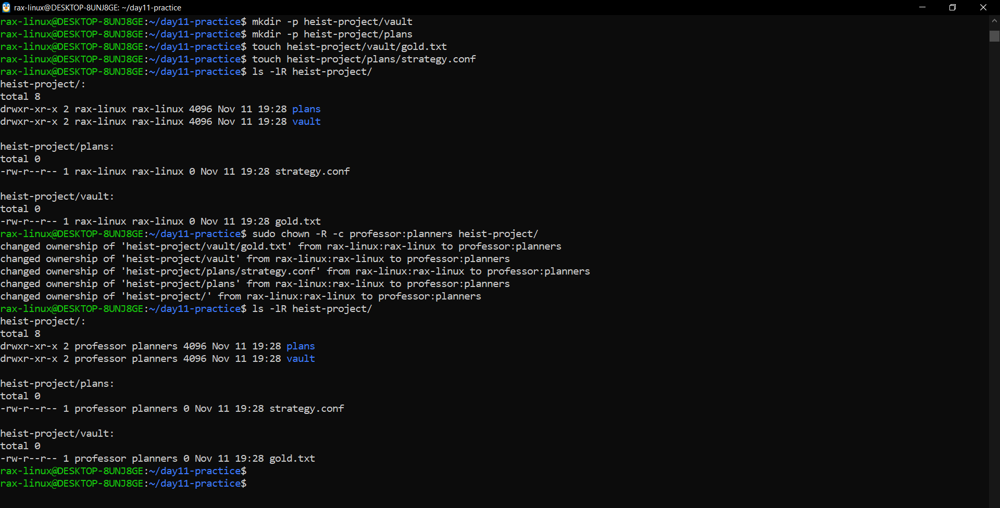
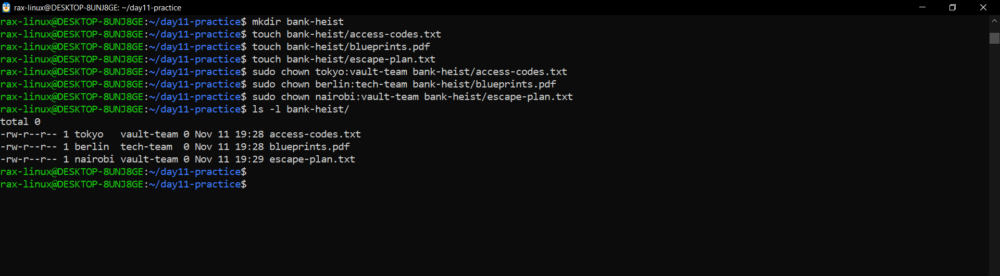
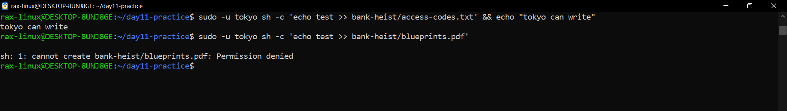
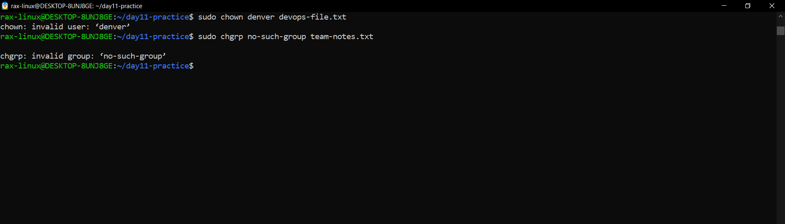
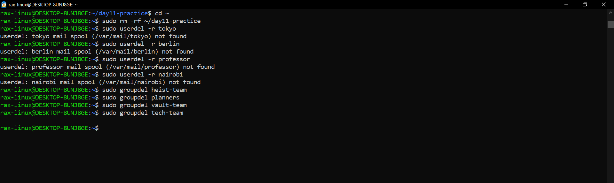

# File Ownership (Day 11)

Ubuntu 22.04 on WSL2. I did this in a practice folder in my home and not on the Windows drive, because on the Windows drive chown doesn't really work (same reason as Day 6 and Day 10).

On Day 9 I deleted tokyo, berlin, professor and nairobi at the end, so I made them again here.

---

## Setup: users and groups

```bash
mkdir -p ~/day11-practice
cd ~/day11-practice
sudo useradd -m -s /bin/bash tokyo
sudo useradd -m -s /bin/bash berlin
sudo useradd -m -s /bin/bash professor
sudo useradd -m -s /bin/bash nairobi
sudo groupadd heist-team
sudo groupadd planners
sudo groupadd vault-team
sudo groupadd tech-team
getent passwd tokyo berlin professor nairobi
getent group heist-team planners vault-team tech-team
```

Why I used these:
- `useradd -m -s /bin/bash` - makes the user with a home folder and bash (Day 9)
- `groupadd` - makes the group
- `getent` - checks that all users and groups really exist. chown fails if the user or group is missing

No passwords this time, because I never login as these users today. chown only needs the user to exist.



I typed my sudo password wrong 3 times on the first try, so tokyo didn't get created and I had to run it again. That's why berlin got id 1001 and tokyo 1002.
All 4 users and all 4 groups (1005 to 1008) are there in getent.

---

## Task 1: Understanding ownership

```bash
ls -l ~
id
ls -n ~
```

Why I used these:
- `ls -l` - shows the owner and group of every file
- `id` - shows my user, my main group and all the groups I'm in
- `ls -n` - same as `ls -l` but shows the numbers (user id and group id) instead of names. Linux really saves the number, the name is just looked up

`ls -l` shows ownership like this:

```
-rw-r--r-- 1 rax-linux rax-linux 31 Nov 7 23:34 backup.sh
               owner     group
```

- **owner** - one user who owns the file. The first 3 permission letters (rw-) are for this user
- **group** - one group that the file belongs to. The middle 3 letters are for everyone in this group
- everyone else gets the last 3 letters



Everything in my home is owned by rax-linux and the group is also rax-linux, because that's my own main group.
`id` shows I'm user 1000 and also in groups like sudo, and `ls -n` shows the same files as 1000 1000.

---

## Task 2: chown (change owner)

```bash
touch devops-file.txt
ls -l devops-file.txt
sudo chown tokyo devops-file.txt
ls -l devops-file.txt
sudo chown berlin devops-file.txt
ls -l devops-file.txt
chown tokyo devops-file.txt
```

Why I used these:
- `chown <user> <file>` - changes only the owner, the group stays the same
- `sudo` - only root can give a file away to another user
- the last `chown` without sudo is on purpose, to see what happens if a normal user tries



The owner went rax-linux → tokyo → berlin, but the group stayed rax-linux the whole time. chown with just a name only touches the owner.
Without sudo it said `Operation not permitted`. Only root can give a file away.

---

## Task 3: chgrp (change group)

```bash
touch team-notes.txt
ls -l team-notes.txt
sudo chgrp heist-team team-notes.txt
ls -l team-notes.txt
sudo chown :planners team-notes.txt
ls -l team-notes.txt
```

Why I used these:
- `chgrp <group> <file>` - changes only the group, the owner stays the same
- `chown :<group> <file>` - same thing with chown, a `:` with nothing before it means "only the group"



The group went rax-linux → heist-team → planners, and the owner stayed rax-linux.
So `chgrp heist-team` and `chown :heist-team` do the same job.

---

## Task 4: Owner and group in one command

```bash
touch project-config.yaml
sudo chown professor:heist-team project-config.yaml
ls -l project-config.yaml
mkdir app-logs
sudo chown berlin:heist-team app-logs
ls -ld app-logs
```

Why I used these:
- `chown owner:group` - changes both at once, the `:` separates them
- `ls -ld` - shows the folder itself, not what's inside



project-config.yaml is now professor heist-team, and the app-logs folder is berlin heist-team. One command changed both.
chown works the same on a folder as on a file.

---

## Task 5: Recursive ownership

```bash
mkdir -p heist-project/vault
mkdir -p heist-project/plans
touch heist-project/vault/gold.txt
touch heist-project/plans/strategy.conf
ls -lR heist-project/
sudo chown -R -c professor:planners heist-project/
ls -lR heist-project/
```

Why I used these:
- `mkdir -p` - makes the folder and the folders inside it in one go
- `-R` - recursive, changes the folder and everything inside it
- `-c` - prints a line for every file that changed, so I can see what -R really did
- `ls -lR` - lists the folder and all the folders inside it, so I can check every file changed

Careful with `-R`: it changes everything under the path. One wrong path like `/` and the whole system breaks.



Before, all 5 things were rax-linux. `-c` printed 5 "changed ownership" lines: both files, both folders and heist-project itself.
After, `ls -lR` shows professor planners everywhere, so one command did the whole tree.

---

## Task 6: Practice challenge

```bash
mkdir bank-heist
touch bank-heist/access-codes.txt
touch bank-heist/blueprints.pdf
touch bank-heist/escape-plan.txt
sudo chown tokyo:vault-team bank-heist/access-codes.txt
sudo chown berlin:tech-team bank-heist/blueprints.pdf
sudo chown nairobi:vault-team bank-heist/escape-plan.txt
ls -l bank-heist/
```



All 3 files got exactly the owner and group the task asked for: tokyo vault-team, berlin tech-team, nairobi vault-team.
Same folder, but every file can belong to a different person and team.

### Does the ownership really work?

```bash
sudo -u tokyo sh -c 'echo test >> bank-heist/access-codes.txt' && echo "tokyo can write"
sudo -u tokyo sh -c 'echo test >> bank-heist/blueprints.pdf'
```

Why I used these:
- `sudo -u tokyo sh -c '...'` - runs the whole command as tokyo, including the `>>`. Without `sh -c` the `>>` would run as me, not as tokyo
- the first one is tokyo writing to his own file, the second one is tokyo writing to berlin's file



tokyo could write to access-codes.txt because he owns it, so it printed "tokyo can write".
blueprints.pdf belongs to berlin and tech-team, tokyo is neither, so he got Permission denied. The ownership really decides who can write.

---

## Extra: what if the user doesn't exist?

```bash
sudo chown denver devops-file.txt
sudo chgrp no-such-group team-notes.txt
```



Both failed with `invalid user: 'denver'` and `invalid group: 'no-such-group'`. chown and chgrp only work with users and groups that exist.

The 3 different errors on Day 11:
- `invalid user` / `invalid group` - the name doesn't exist
- `Operation not permitted` - a normal user tried to give a file away (needs sudo)
- `Permission denied` - the user exists but has no permission on the file (Day 10)

---

## Clean up

```bash
cd ~
sudo rm -rf ~/day11-practice
sudo userdel -r tokyo
sudo userdel -r berlin
sudo userdel -r professor
sudo userdel -r nairobi
sudo groupdel heist-team
sudo groupdel planners
sudo groupdel vault-team
sudo groupdel tech-team
```

`sudo rm` is needed because the files belong to other users now.



Everything got removed. The `mail spool not found` lines are normal, same as Day 9, these users never got any mail.

---

## Files & Directories Created

| Path | Type |
|---|---|
| devops-file.txt | file |
| team-notes.txt | file |
| project-config.yaml | file |
| app-logs/ | folder |
| heist-project/vault/gold.txt | file in a folder |
| heist-project/plans/strategy.conf | file in a folder |
| bank-heist/access-codes.txt | file |
| bank-heist/blueprints.pdf | file |
| bank-heist/escape-plan.txt | file |

## Ownership Changes

| Path | Before | Command | After |
|---|---|---|---|
| devops-file.txt | rax-linux:rax-linux | `chown tokyo` | tokyo:rax-linux |
| devops-file.txt | tokyo:rax-linux | `chown berlin` | berlin:rax-linux |
| team-notes.txt | rax-linux:rax-linux | `chgrp heist-team` | rax-linux:heist-team |
| team-notes.txt | rax-linux:heist-team | `chown :planners` | rax-linux:planners |
| project-config.yaml | rax-linux:rax-linux | `chown professor:heist-team` | professor:heist-team |
| app-logs/ | rax-linux:rax-linux | `chown berlin:heist-team` | berlin:heist-team |
| heist-project/ (everything inside) | rax-linux:rax-linux | `chown -R professor:planners` | professor:planners |
| bank-heist/access-codes.txt | rax-linux:rax-linux | `chown tokyo:vault-team` | tokyo:vault-team |
| bank-heist/blueprints.pdf | rax-linux:rax-linux | `chown berlin:tech-team` | berlin:tech-team |
| bank-heist/escape-plan.txt | rax-linux:rax-linux | `chown nairobi:vault-team` | nairobi:vault-team |

## Commands Used

| Command | What it does |
|---|---|
| `useradd -m -s /bin/bash <user>` | makes a user with a home folder and bash |
| `groupadd <group>` | makes a group |
| `getent passwd <user>` / `getent group <group>` | checks the user or group exists |
| `ls -l` | shows owner and group of files |
| `ls -n` | same, but with user and group numbers |
| `id` | shows my user and all my groups |
| `sudo chown <user> <file>` | changes only the owner |
| `sudo chgrp <group> <file>` | changes only the group |
| `sudo chown :<group> <file>` | changes only the group, with chown |
| `sudo chown <user>:<group> <file>` | changes owner and group together |
| `ls -ld <folder>` | shows the folder itself, not what's inside |
| `sudo chown -R -c <user>:<group> <folder>` | changes the folder and everything inside, prints each change |
| `ls -lR <folder>` | lists the folder and every folder inside it |
| `sudo -u <user> sh -c '...'` | runs a command as another user |
| `userdel -r <user>` / `groupdel <group>` | deletes the user (with home) or the group |

## What I Learned

- Every file has one owner and one group. The owner gets the first rwx, the group the middle rwx, everyone else the last
- `chown user` only changes the owner, `chgrp` or `chown :group` only the group, and `chown user:group` both at once
- `-R` changes a whole folder tree in one go, and `-c` shows what it changed. Useful, but one wrong path can break a system
- Only root can give a file to another user. A normal user gets `Operation not permitted`
- In real DevOps this is how an app's files are given to the user the app runs as, for example the web server's files to www-data
