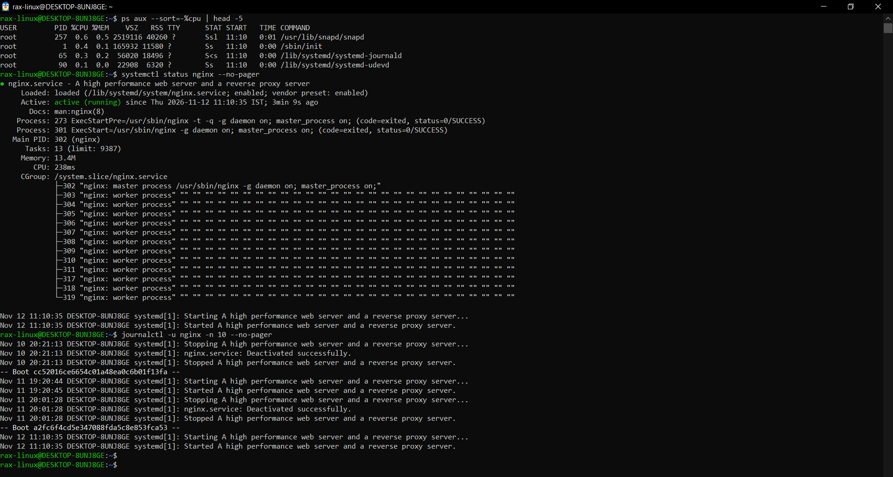
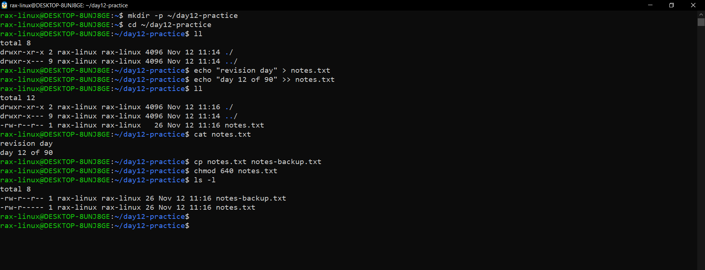
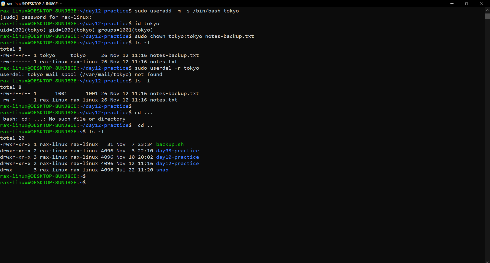
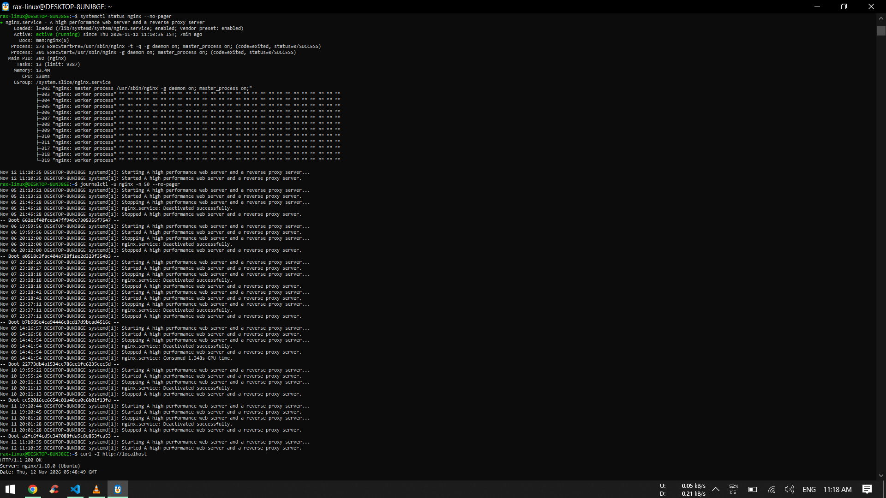

# Revision: Day 01 to Day 11 (Day 12)

No new topic today. I went back over everything from the first 11 days, re-ran a few commands on my machine (Ubuntu 22.04 on WSL2), and wrote down what I remember and what still feels shaky.

---

## What I covered in 11 days

| Day | Topic | One thing I remember |
|---|---|---|
| 01 | Learning plan | my 3 goals: containers + CI/CD, cloud + monitoring, agentic AI |
| 02 | Linux architecture | systemd is PID 1, `/sbin/init` is just a link to it |
| 03 | Commands cheat sheet | `--sort=-%cpu` needs the minus, without it the lowest CPU comes first |
| 04 | Processes and services | `systemctl stop` sends SIGTERM, same as `kill` |
| 05 | Troubleshooting runbook | in `free -h` look at "available", not "free" |
| 06 | Read and write files | `>` replaces the whole file, `>>` adds at the end |
| 07 | File system + scenarios | stopped is not the same as disabled |
| 08 | First cloud server | if `curl localhost` works but the browser doesn't, check the security group |
| 09 | Users and groups | always `usermod -aG`, never just `-G` |
| 10 | File permissions | x on a folder means "can go inside" |
| 11 | File ownership | only root can give a file to another user |

---

## How sure am I? (honest check)

| Skill | Mark |
|---|---|
| find and stop a process (`ps`, `kill`) | can do |
| check a service and its logs (`systemctl`, `journalctl`) | can do |
| `>`, `>>`, `2>`, `tee` | can do |
| where things live (`/etc`, `/var/log`, `/opt`) | can do |
| users and groups (`useradd`, `usermod -aG`) | can do |
| `chmod` numbers (644, 755, 640) | can do |
| `chown`, `chgrp`, `-R` | can do |
| setgid shared folders (`chmod 2775`) | shaky, did it only once on Day 9 |
| vim | shaky, still look up how to save and exit |
| networking (`ss`, `dig`, ports) | shaky, only used lightly on Day 3 |

---

## 1. Day 01 plan check

I read my Day 01 learning plan again.

- My 3 goals are still right. Day 8 already put me on a real AWS server with nginx and Docker, which is the start of goal 1 and 2.
- The "one GitHub commit every day" rule is working, every day so far is on GitHub.
- Two small things I'm adding to the plan:
  - always terminate cloud resources after a lab, so there's no surprise bill
  - keep a short "mistakes I made" list, because I learn the most from them (wrong sudo password, starting `yes` twice, `--sort` without the minus)

---

## 2. Processes and services

```bash
ps aux --sort=-%cpu | head -5
systemctl status nginx --no-pager
journalctl -u nginx -n 10 --no-pager
```

Why I used these:
- `ps aux --sort=-%cpu` - the first thing I check when a server feels slow (Day 3, 5)
- `systemctl status` - is the service running, enabled, and its last few logs (Day 4)
- `journalctl -u nginx -n 10` - the last 10 log lines of just nginx (Day 4, 5)



Top CPU user is snapd at only 0.6%, so the system is idle. nginx is active (running) and enabled, 1 master + 12 workers like on Day 5.
The logs show nginx stopping every time I closed WSL (Nov 10, Nov 11) and starting again on the next boot. That's "enabled" working, it comes back by itself after a reboot.

---

## 3. File skills

```bash
mkdir -p ~/day12-practice
cd ~/day12-practice
echo "revision day" > notes.txt
echo "day 12 of 90" >> notes.txt
cat notes.txt
cp notes.txt notes-backup.txt
chmod 640 notes.txt
ls -l
```

Why I used these:
- `echo >` then `echo >>` - write one line, then add a second one without deleting the first (Day 6)
- `cp` - a backup copy before changing anything, a habit from Day 8
- `chmod 640` - owner rw, group r, others nothing (Day 10)
- `ls -l` - to check the permissions really changed



`cat` shows both lines, so `>>` added the second line without deleting the first.
After `chmod 640`, notes.txt is `-rw-r-----` but the backup is still `-rw-r--r--`. chmod only changes the file I give it, not its copies.

---

## 4. User and ownership

```bash
sudo useradd -m -s /bin/bash tokyo
id tokyo
sudo chown tokyo:tokyo notes-backup.txt
ls -l
sudo userdel -r tokyo
ls -l
```

Why I used these:
- `useradd` + `id` - make a user and check it really exists (Day 9)
- `chown tokyo:tokyo` - give the backup file to tokyo, owner and group in one command (Day 11)
- `userdel -r` then `ls -l` - delete tokyo and see what happens to his file



tokyo got id 1001 and after chown the backup file showed `tokyo tokyo`.
After `userdel`, the file didn't go away, `ls -l` just shows `1001 1001` because the name is gone but the number is still saved on the file (same as `ls -n` on Day 11). If a new user gets id 1001 later, they will own this file, so files should be cleaned up or given back before deleting a user.
(I also typed `cd ...` by mistake, it should be `cd ..`.)

---

## 5. Cheat sheet refresh: my first 5 commands in an incident

From my Day 3 cheat sheet, these are the ones I'd type first when something breaks:

| # | Command | Why first |
|---|---|---|
| 1 | `systemctl status <service>` | is it even running? also shows the last logs |
| 2 | `journalctl -u <service> -n 50` | what did it say before it broke |
| 3 | `ps aux --sort=-%cpu \| head` | is something eating the CPU |
| 4 | `df -h` and `free -h` | is the disk or the memory full |
| 5 | `curl -I http://localhost` | does the app actually answer, not just run |

---

## Mini self-check

**1) Which 3 commands save me the most time right now, and why?**

- `systemctl status` - one command tells me running or not, enabled or not, the PID and the last log lines
- `ps aux --sort=-%cpu | head` - finds the process eating the CPU in a second
- `ls -l` - most "it doesn't work" problems on Day 7, 10 and 11 were permissions or ownership, and `ls -l` shows both

**2) How do I check if a service is healthy?**

```bash
systemctl status nginx --no-pager
journalctl -u nginx -n 50 --no-pager
curl -I http://localhost
```

Running is not the same as healthy. Status says if it's running, the logs say if it's complaining, and curl says if it really answers.

I ran all 3 on nginx:



Status is active (running), the last 50 log lines are only normal starts and stops (no errors), and curl got `HTTP/1.1 200 OK` from nginx/1.18.0. So nginx is healthy.

**3) How do I change ownership and permissions safely?**

- check first with `ls -l` (or `ls -ld` for a folder)
- change only the one thing that's needed, never `chmod 777`
- be extra careful with `-R`, one wrong path changes everything under it
- check again with `ls -l` after

Example:

```bash
sudo chown -R -c app:app /opt/app
```

`-c` prints every file it changed, so I can see exactly what happened.

**4) What will I focus on in the next 3 days?**

- Day 13 is LVM (disks and volumes), which is new for me
- Day 14 and 15 are networking. On Day 3 I only used `ping`, `curl` and `dig` lightly, so I want to understand ports, DNS and subnets properly
- and keep practicing vim, because on Day 10 I still had to look up how to save and exit

---

## Key takeaways

- I can still do the basics without looking: `ps`, `systemctl status`, `journalctl -u`, `>>`, `chmod`, `chown`
- "enabled" is why nginx came back by itself after every WSL restart
- running and healthy are different things, `curl` is the real test
- deleting a user leaves their files behind with just a number as the owner
- my weak spots for the next days are vim, setgid and networking
